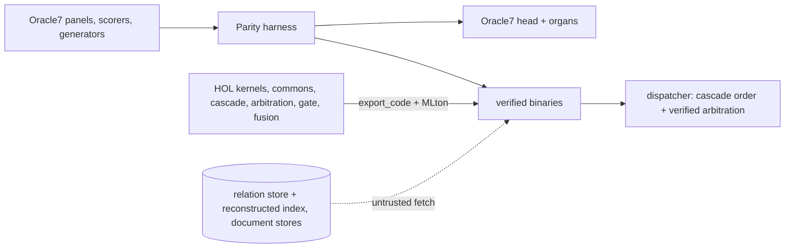

# veri7vn

veri7vn develops native computation and reasoning components for
[Oracle7](https://huggingface.co/psiloceyeben/oracle7). It contains Isabelle
functions compiled to Standard ML, a Rust query and reasoning runtime, and a
shared service that exposes these components to agents.

The aim is to answer more questions correctly with less memory and computation,
and to state the assumptions behind each answer.
There are implementations for 145 non-relation specialist IDs (including the
new `meteorology-v2`) and one
kernel serving the 161 relation readers. Connecting every capability through
the combined runtime, strengthening its proofs and completing the specialists'
intended algorithms are active work.

Specialist repairs cover dropped signs, lost units, mistaken subjects and
answers to the wrong requested quantity, including cases absent from the shipped
tests. See the [specialist record](project/APPLIANCE-2026-10-26.md) and
[current native work](native/docs/ROADMAP.md).

A proof establishes a particular statement about a computation. It can show
that a result satisfies an equation or a decision follows from supplied rows.
It does not establish that an English question was read correctly, a physical
model fits the world, or a fetched record is true. Those boundaries matter as
much as the calculation.

## Native runtime and appliance

The [Rust host](native/docs/HOST.md) serves questions, operation discovery and
direct computations independently of minidregg. It shares an immutable indexed
image, keeps selected extracted kernels resident and contains the Python Oracle7
Engine in a bounded worker pool. A relocatable package keeps public data and
private state outside its code payload. [Build and use it](native/README.md).

The [capability catalog](native/docs/CAPABILITIES.md) describes callable graph,
exact optimization, symbolic, scientific, statistical, biological and logic
operations. Current workflows include calibration, events/exposure models,
sequential monitoring, thermal scenarios and transients, exact blends, sequence
search and coordinate-preserving translation. Their manufactured workflow cases
are separate from the shipped specialist exams. A structured operation does not
automatically become a natural-language specialist in the complete Oracle cascade.

The native reader supports the pinned KQA program vocabulary, learned templates
and bounded composition. It retains 36 correct answers on the original
100-question control. A repaired plural-first export improves the targeted
16-question cohort from two to ten correct, with six expected declines and no
wrong answers or execution errors in those release runs. The latest representation
changes preserve both cohorts' answers and evidence. Coverage and performance
limits are in the catalog and [performance report](native/docs/PERFORMANCE.md).

Native sessions persist selections, explicit scalar state and revisable evidence;
retries survive lost replies and restart. Front-door native reads and Python
fallback do not yet share a complete conversation. Each Engine worker belongs to
one tenant per generation; eviction requires reset unless its state has an
explicit supported restoration path. Full Engine restoration, wider reader
coverage, sustained mixed-tenant qualification and release-history migration remain.
The [roadmap](native/docs/ROADMAP.md) is the live plan; the
[migration map](native/docs/MIGRATION.md) identifies remaining source consumers.

The [latest completed native cycle](project/lanes/NATIVE-NEXT-CYCLES-2026-10-31.md)
records typed host calls, packed reader programs, contiguous graph checking and
resumable evidence clients. Its code and evidence are pushed and
[shared upstream](project/lanes/NATIVE-UPSTREAM-CHECKPOINT-2026-10-31.md).
Separate [design experiments](native/experiments/README.md) explore streaming
queries, maintained views and conditional formulas. Those experiments remain
outside service registration; their fixtures are not deployed capability claims.

## Minidregg integration

The appliance is intended for agents inside a
[minidregg](https://github.com/emberian/minidregg) grain. Mini supplies authenticated
principals and application grants; agents discover and call admitted operations
through `mini_oracle_discover` and `mini_oracle_call`. Its
[appliance overview](https://github.com/emberian/minidregg/blob/main/docs/oracle-appliance.md)
describes the receiving system. Mini admission and the fresh agent/browser/restart
journey belong to that team; this repository supplies the runtime and its contracts.

Public stores are published separately and mounted read-only, shared between
grains in a Store. The retained signed data inventory is about 15 GB; it does not
need per-grain copies or SPK chunking. Private state remains separate. The
[31 October signing receipt](native/evidence/2026-10-31-mini-rust-stage.json)
records a Linux Rust/U8 candidate, its signature and independently checked package
inventory. Native development has advanced beyond that exact candidate; it does
not contain every later provider or prove receiving qualification of current code.

Earlier signed packages answered through Mini in two independent grains. A
separate 57-request Engine usage check completed 37 tasks, appropriately refused
or clarified 13, and left seven valid tasks incomplete, with no wrong answers
observed in those records. These historical checks do not establish a current
public Dreggnet deployment. [Materialization tools](deploy/appliance/README.md)
and the [operation interface](tools/appliance/README.md) retain their exact scope.

## Measurements

Full table with every run: [`docs/parity/BOARD.md`](docs/parity/BOARD.md).

This table records particular runs, not a single current fleet result.
Correct refusals count as right. False yes means answering a question that
requires refusal; wrong means an incorrect answer. A standalone family score
does not measure all six admission criteria, which also test composition,
interference with other routes, identity handling and latency.

| Answerer | Recorded measurement | Scope and limits |
|---|---|---|
| Oracle7 as shipped (published) | 15,478 / 14 | the control |
| Oracle7 as shipped, reproduced here | 14,667 / 17 false yes | the 129 non-relation readers exact; the 161 relation readers run on a reconstructed linker index over the v1 store, and the 811 missing answers sit on properties the shipped store does not contain |
| veri7vn: all 144 non-relation specialist IDs have implementations | no consolidated current score | individual repairs and extensions are being checked and integrated; see the current continuation |
| Earth including new meteorology-v2 (26 Oct; `project/lanes/AP1-meteorology.md`) | 664/664 shipped panel items across nine IDs, 0 wrong/false yes, identical macOS/Linux replies | meteorology-v2 is 110/110 plus 59 independent quantity probes; registry now has 145 non-relation IDs; no new fleet-wide qualification |
| Space, mechanics/space packet (18 Oct; `project/lanes/C-physical-mechanics-space.md`) | 1,185 / 1,185 right, 0 wrong, 0 false yes when pinned across eight specialists on shipped dev and held-out panels | the measured binary repairs astronomy and spacecraft cases; family mode scores 1,183 / 1,185, with two false yes outside the planetary panel's narrow scope |
| Chemistry D (`54c6727`; `project/lanes/D-chemistry.md`) | 1,206 / 1,206 shipped-panel items right, 0 wrong, 0 false yes across five specialists | D's authored capability challenge classified 118 mathematically right, 0 wrong and 20 valid-but-unsupported withholds; its 138/138 direct and composed checks are policy regressions, not newly correct computations |
| Selected Stores E package (`project/lanes/E-symbolic-stores.md`, `project/lanes/C-runtime-package.md`) | all 2,476 shipped replies match between bound Darwin and Linux binaries; relocated cooking-v3 and warehouse score 811 / 818 right, 0 wrong, 0 false yes, 55 withheld on both platforms | this is the selected E package; ambiguous servings may require clarification, and speculative host calls cannot place orders |
| veri7vn: one relation kernel, 161 readers | 16,284 / **0** of 18,976 panel items | the shipped organs score 16,261 / 11 on the same store; all panel questions are valid, so this does not measure false yes |
| veri7vn: fusion (`network_v3`) | 101 of 102 of Oracle7's fusion answers identical | the last needs the geometry kernel |
| veri7vn beyond parity: chemistry and finance families (B-chemistry, B-finance, 2026-10-18) | chemistry/chemistry-v3 held-out 281 / 0 wrong / 0 withheld against the shipped organ's 223 / 2 / 56, decay 42/42 against 34/42; finance 129/0/0 against 116/0/13, economics 78/0/0 against 65/0/13; same on fresh generator seeds; cold starts 58 and 270 ms → 4 and 3 ms; the shipped retail organ ignores the sales tax it is asked to add (fixed) | the second scoreboard (`project/swarm/BEYOND.md`): 0 wrong stays the law, the other numbers move |
| Earlier package of 125 specialists, W5-11 | organs alone: 11,802 right / 0 false yes / 46 wrong on 12,247 dev and held-out questions | with w540 behind them: 11,844 / 14 / 71; this predates the chemistry and finance improvements |
| Separate head-route components | word problems 24/24 core items; precision guards 114/114 recorded declines; document W5-18: 225/231 status | component measurements; full dispatcher integration is unfinished |
| Dialogue scorer | 236 of 237 recorded Oracle7 verdicts reproduced | this tests the scorer, not veri7vn's dialogue ability; the scout kernel itself scored 161/237 |

Some recorded runs contain wrong answers. Family repairs do not establish a
clean fleet result; the [18 October record](project/CODEX-2026-10-18.md)
explains the corrections and outstanding work from those runs.

In the earlier fleet measurement, 19 binaries occupied 12 MiB on disk, started
in milliseconds, used 4–10 MiB each, with median 0.1 ms per question. Oracle7's head
on the same questions: 3.6 s to start, 140 ms median, 1.96 GB resident
([`docs/performance/fleet.md`](docs/performance/fleet.md)).

## Extracted specialist package

The [specialist package](docs/handoff/organ-package.md) can be installed under
Oracle7's `root/specialists/` without a veri7vn checkout. The recorded package
contains 125 specialist folders and macOS/Linux binaries. Its 12,247 panel
replies matched the individual family runs on both platforms, including their
errors. The package document records source identities, test limitations and
differences between Oracle7's exam and runtime routing.

The refreshed registry includes earth and finance, and dispatch and packaging
share explicit rules for new answer kinds. Stores now has a relocatable fetcher
tested on both platforms. Warehouse wrappers default to read-only previews
because Oracle7 may query several candidates before selecting an answer.
The project dispatcher can preview, apply guards, then commit a selected
warehouse turn once. A refreshed complete archive awaits the remaining family
builds; the older archive's measurements are kept separate.

## How the pieces fit



A **kernel** is a HOL function from a typed request to a typed outcome, with a
theorem that the outcome satisfies the defining equation (or that a decline is
exactly the stated condition). The **recognizer** that turns English into a
typed request is ordinary code and is labelled untrusted. A **fetch** over a
store is untrusted too. Where a decision needs all relevant rows, its proof
depends on an explicit completeness premise; checking the rows received cannot
establish that none were omitted. Isabelle exports each kernel to
Standard ML; MLton, which ships inside Isabelle, compiles it to a binary that
speaks the [answerer contract](docs/contracts/answerer.md). No Isabelle process
runs at answer time; builds run on hbox and persvati through
`tools/dev/remote-build`. Shared numeric and text machinery lives in
`src/extract/commons/`.

The runtime reports routes and some source and theorem metadata. Connecting each
answer to the assumptions and guarantees of its computation remains unfinished.

## Layout

| Path | What |
|---|---|
| `native/` | Rust runtime, optional providers, PyO3 bindings and service documentation |
| `tools/appliance/`, `tools/oracle_components/` | HTTP serving, worker pools and operation adapters |
| `project/PLAN.md`, `project/swarm/` | the plan; lane waves (`WAVE5.md`, `WAVE6.md`), the lane brief, the beyond-parity recipe (`BEYOND.md`) |
| `project/lanes/*.md` | one handoff per lane: theorem statements, numbers, receipts, limits |
| `project/scouts/` | GLM scout briefs, their reports, the triage logs (`TRIAGE-N.md`) |
| `docs/parity/` | the board, the harness manual, dialogue mode |
| `docs/oracle7/CORE.md` | what Oracle7 actually is, with file pointers and route shares |
| `docs/assurance/` | the theorem-quality audit |
| `src/extract/<family>/` | one lifted family each: theories, recognizer, build, scorer, README; `families.json` is the registry |
| `src/extract/commons/` | shared numeric core and SML library |
| `src/isabelle/{routing,specialists,reader,document}/` | the cascade, the contract/arbitration/gate, the exact relation reader, the document route |
| `tools/parity/`, `tools/dispatch/`, `tools/lint/`, `tools/organs/`, `tools/linker/`, `tools/perf/`, `tools/deploy/` | harness, dispatcher, specialist linter, organ package, linker reconstruction, fleet measurement, Linux builds |
| `tools/dev/`, `tools/scout/` | build driver and remote builds; scout launcher and queue |
| `audit/`, `docs/coverage/` | the fold catalogue and the coverage audit of all 305 manifests |
| `upstream/`, `var/` | the Oracle7 drop and local scratch; ignored by git |

## Running things

```sh
# the original Oracle7, from the 43 GB drop (not in git); subshell keeps later paths at the checkout root
(cd upstream && ../.venv/bin/python -B oracle7.py "Who wrote Leaves of Grass?")

# a verified family on its own shipped panels
PYTHONDONTWRITEBYTECODE=1 python3 tools/parity/harness.py \
  --answerer "var/quantity/bin/quantity" --specialist densities,units --split both --out var/parity/demo

# one relation reader on the reconstructed index; {id} is supplied by the harness
ORACLE7_ROOT=var/linker/o7root python3 tools/parity/harness.py \
  --answerer "python3 -B tools/relations/answerer.py --specialist {id}" \
  --specialist rel-novels --split both --out var/parity/relations

# a remote Isabelle session, with generated SML and the build receipt brought back
tools/dev/remote-build hbox src/extract/quantity Veri7vn_Quantity \
  -d src/extract/commons --expect 'VERI7VN_QUANTITY PASS'
```

Read [AGENTS.md](AGENTS.md) before working here. One Isabelle distribution
locally (`/Applications/Isabelle2026-RC1.app`); nothing writes under
`upstream/`; remote builds use `tools/dev/remote-build`, and a build counts as
green only when its receipt reports success.

## What is not done

The 30 properties absent from the shipped relation store (1,814 panel items)
need data that did not ship. English recognizers remain outside the proofs.
Several audited theorems restate definitions rather than establish the intended
specification; `docs/assurance/` records the findings, and the Wave-6 work records
repairs. That backlog still needs a current audit. Implementation and integration span multiple
specialist families, with scoped measurements recorded in the continuation and
lane reports; they do not establish a complete refreshed fleet result. The code
organ remains an authorized capability frontier, but it has no panel and no
core-panel question reaches it, so there is no measured implementation result
yet. General computer algebra remains a proposal; the native service currently
supports the narrower exact polynomial operations in its
[capability catalog](native/docs/CAPABILITIES.md).

The original fleet audit used Oracle7 revision
`c5d6a29d5bc5e2525078e5a53afa1abf659e4d69`; later native and appliance receipts
name their own source revisions.
Code here is CC0 (`LICENSE.md`); Oracle7 itself is Apache-2.0 code with
per-source data licences (`upstream/DATA_LICENSES.md`).
