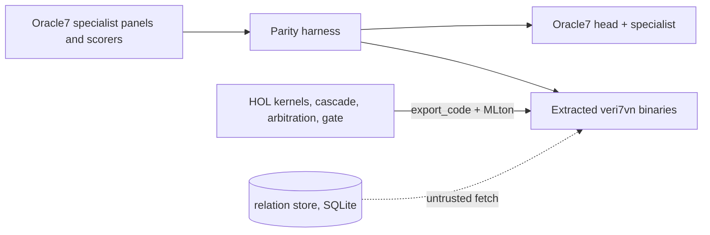

# veri7vn

**Oracle7's sibling, with an Isabelle spine.**

[Oracle7](https://huggingface.co/psiloceyeben/oracle7) is an AI that answers from
stored, sourced records and 267 specialists, says "I can't verify that" instead
of guessing, and shows the path every answer took. veri7vn keeps that shape and
adds what Python cannot give it:

- **Assurance.** The formulas a specialist computes, the rule that routes a
  question, the rule that arbitrates between two specialists, and the exam that
  admits a new one are written in Isabelle/HOL with proofs about them.
- **Metareflective access.** The running system can state what its own
  admission, routing and composition mean, and check a claim against that
  statement, instead of only reporting a score.
- **Both directions.** A proved kernel compiles to a small binary that can sit
  inside Oracle7 as one of its organs; an Oracle7 specialist with its panel can be
  brought into veri7vn and examined there.

veri7vn is being built as a gift back to Oracle7's author. Everything it claims is
measured on Oracle7's own specialist panels, with Oracle7's own scorers, under
the six criteria of Oracle7's own exam.

## The board

| Answerer | Specialists' panels right / wrong | Status |
|---|---|---|
| Oracle7 as shipped | 15,478 / 14 on the held-out exams (6,354 / 5 for the 144 non-relation specialists; 9,124 / 9 for the 161 relation readers, whose stores did not ship) | the control; the harness reproduces all 129 non-relation verdicts exactly (`docs/parity/BOARD.md`) |
| veri7vn revision-2 package (2026-10-16 morning) | 0 / 0, every panel item unrecognized | the starting line |
| veri7vn extracted `acoustics` binary (2026-10-16 night) | 69 / 0 on its 69 held-out items and 70 / 0 on dev, same as the shipped organ; 428 KB, 12 ms median, 0 false yes; also packaged as a drop-in Oracle7 specialist folder (`src/extract/acoustics/oracle7-organ/`) | first lifted specialist, at parity |
| veri7vn verified relation reader (2026-10-16 evening) | 60 answers on Oracle7's 205 relation-route core-panel items, 60 identical to Oracle7, 0 wrong | first lifted route |
| veri7vn `quantity` binary: densities, units, units-v3, springs, fluids, fuels (2026-10-17) | 320 / 0 on the six held-out panels and 321 / 0 on dev, same as the shipped organs; one 545 KB binary, 7 ms cold start, 0.2 ms median | one kernel, six specialists, at parity |
| veri7vn `fusion` binary: Oracle7's `network_v3` planner over the quantity kernels (2026-10-17) | 60 of the 102 core-panel fusion answers identical to Oracle7's text and route, 0 wrong; the other 42 need thermo, carboncapture and planetary kernels; 327 KB, 1.2 ms median | fusion proved: shallowest-depth agreement within 0.5% or decline |

`docs/parity/BOARD.md` is regenerated by the parity harness as lanes land. See
[the plan](project/PLAN.md) for what is being built right now and by whom.

## What runs today

**The original Oracle7**, from the 43 GB drop under `upstream/` (not in git):

```sh
cd upstream && ../.venv/bin/python oracle7.py "Who wrote Leaves of Grass?"
# [ev:direct] Walt Whitman. ... [answered] path: organ:relation>READ>FRAME>LINK>RELATE:inv:P800>...
```

About eleven seconds cold, well under a second per turn after that.

**The revision-2 veri7vn package** (macOS ARM64, built by the previous
development swarm) launches without system Python and answers exact arithmetic
phrased as "the sum of -2 and 3", with its result and provenance surviving a
restart. It recognizes nothing else. It is kept as a baseline, not developed.

## How the pieces fit



A **kernel** is a HOL function from a typed request to a typed outcome, with a
theorem that the outcome satisfies the defining equation (or that a decline is
exactly the stated underspecified or impossible case). The **recognizer** that
turns English into a typed request is ordinary code and is labelled untrusted.
A **fetch** over a store is likewise untrusted, and the verified decision only
answers when the fetch asserts it returned every relevant row. Isabelle exports
the kernel to Standard ML; MLton, which ships inside Isabelle, compiles it to a
binary that speaks the [answerer contract](docs/contracts/answerer.md). No
Isabelle process runs at answer time.

## Layout

| Path | What |
|---|---|
| `project/PLAN.md` | the plan, the lanes, what was removed |
| `docs/contracts/answerer.md` | the one protocol every answerer speaks |
| `tools/parity/`, `docs/parity/` | the harness and the board |
| `audit/folds/` | the catalogue of Oracle7's 346 routing folds |
| `src/isabelle/routing/`, `src/isabelle/specialists/`, `src/isabelle/reader/` | the cascade, the contract/arbitration/gate, the relation reader |
| `src/extract/<family>/` | lifted specialists, theory to binary: `acoustics`, `quantity` (six specialists), `fusion` in progress |
| `audit/coverage/`, `docs/coverage/` | audit of all 305 Oracle7 manifests into 81 semantic profiles; still the map |
| `project/lanes/` | one handoff per lane, with theorem statements and numbers |
| `upstream/`, `var/` | the Oracle7 drop and local scratch; ignored by git |

## Working here

Read [AGENTS.md](AGENTS.md). Isabelle builds go through
`python3 tools/dev/check-native` with a scoped session; it holds the one build
lock. One Isabelle distribution, at `/Applications/Isabelle2026-RC1.app`. Nothing
writes under `upstream/`.

The audited Oracle7 revision is `c5d6a29d5bc5e2525078e5a53afa1abf659e4d69`. Code
here is CC0 (`LICENSE.md`); Oracle7 itself is Apache-2.0 code with per-source data licences (`upstream/DATA_LICENSES.md`).
