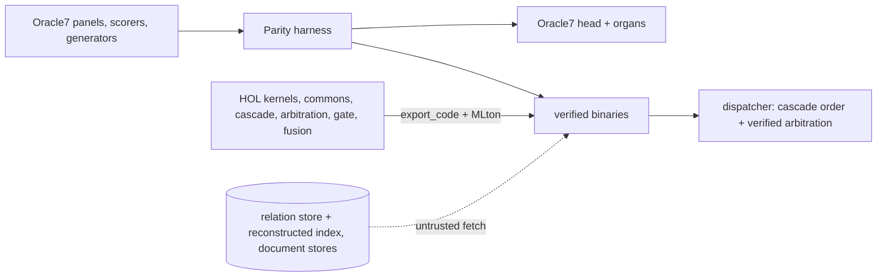

# veri7vn

**Oracle7's sibling, with an Isabelle spine.**

[Oracle7](https://huggingface.co/psiloceyeben/oracle7) answers questions through
specialists, stored records and an ordered series of routing rules. veri7vn
turns those specialists' calculations and decisions into functions with
machine-checked proofs, then compiles them into small programs that can run
inside Oracle7 or on their own.

The aim is to answer more questions correctly, make the assumptions behind an
answer inspectable, and let both systems grow from each other's components.
There are implementations for 145 non-relation specialist IDs (including the
new `meteorology-v2`) and one
kernel serving the 161 relation readers. Connecting every capability through
the combined runtime, strengthening its proofs and completing the specialists'
intended algorithms are active work.

Each specialist is also being examined beyond its shipped question templates.
The original answer is a comparison, not a correctness requirement: dropped
signs, lost units, mistaken subjects and answers to the wrong requested quantity
are repaired even when the old panels pass. The
[current batch](project/APPLIANCE-2026-10-26.md) records integrated changes,
their measured scope and the next substantive defects.

A proof establishes a particular statement about a computation. It can show
that a result satisfies an equation or a decision follows from supplied rows.
It does not establish that an English question was read correctly, a physical
model fits the world, or a fetched record is true. Those boundaries matter as
much as the calculation.

## Minidregg appliance

The appliance packages Oracle7, selected veri7vn kernels, Workbench and companion
tools for use inside a [minidregg](https://github.com/emberian/minidregg) grain.
It supports conversational questions and a searchable catalog of direct
operations: calculations, sourced records, document/table analysis, simulations,
forecast checks and supplied-image tools. Descriptors declare required inputs,
units, availability and implementation limits. Mini agents use
`mini_oracle_discover` and `mini_oracle_call` through their application grants.

A signed Linux runtime contains the code, dependencies and bridge. Its signed
data declaration selects a separately published, immutable public dataset:
about 15 GB, mounted read-only and shared between grains in the same Store.
Signed v7 serves separate authenticated source-session workspaces from a bounded
worker pool; its initial configuration allows one resident worker and 128 tenant
workspaces. Exact completed requests replay without starting a worker. Conversation
context does not yet survive worker retirement, so new turns explicitly require
a fresh conversation after eviction. Large stores need no SPK
chunking or per-grain copy. Mini controls admission and access; packaging a
calculator does not grant permission or prove every answer it produces.

As of 27 October 2026, the catalog exposes 351 direct operations.
A focused 57-request Engine run completed 37 tasks, appropriately refused or clarified
13, and left seven valid tasks incomplete, with no wrong answers observed in
those 57 records. The latest package adds tenant isolation and deferred catalog
loading, checked separately through lifecycle and real Engine tests.
Earlier signed-package tests answered through Mini in two
independent grains. The newer agent lifecycle and complete restart/recovery
journey remain unfinished; this is not a public Dreggnet deployment.

The next shared runtime has a [Rust and PyO3 implementation](native/README.md)
and a [relocatable Linux appliance](native/docs/DISTRIBUTION.md). Its
[standalone service](native/docs/STANDALONE.md) offers discovery and direct calls
through shared bounded workers, independently of minidregg. Graph optimization,
symbolic calculations, exact charge/isotope-conserving
[reaction balancing](native/docs/CHEMISTRY.md), scientific models, dependencies,
DNA alignment and statistical regression operate on supplied inputs.

An optional [durable runtime profile](native/docs/RUNTIME-HOST.md) adds shared
indexed data, complete KQA programs, learned language composition, atomic turns
and release-bound retry journals. Actual HTTP checks cover restart, lost-response
retry and tenant separation. The full Engine cascade, authenticated public
hosting and fresh signed Mini integration remain unfinished. The separate
stable-model reasoning prototype is tested but not yet exposed by this service.

The [migration map](native/docs/MIGRATION.md) separates native capabilities from
remaining Python providers. The [current native checkpoint and backlog](project/NATIVE-EXPANSION-2026-10-29.md)
records delivered work and failures: the original 100-question reader result is
preserved, but a new 16-question composition challenge still has unanswered
questions and storage-limit errors. These samples are not a specialist-fleet score.

Start with the [shared-hosting checkpoint](project/HOSTED-2026-10-27.md),
the [Mini appliance overview](https://github.com/emberian/minidregg/blob/main/docs/oracle-appliance.md),
the [materialization tools](deploy/appliance/README.md), and the
[API and operation catalog](tools/appliance/README.md). The
[current checkpoint](project/CONTINUE-2026-10-27.md) links exact candidates,
measured results and remaining integration work.

## The board

Full table with every run: [`docs/parity/BOARD.md`](docs/parity/BOARD.md).

This table records particular runs, not a single current fleet result.
Correct refusals count as right. False yes means answering a question that
requires refusal; wrong means an incorrect answer. A standalone family score
does not measure all six admission criteria, which also test composition,
interference with other routes, identity handling and latency.

| Answerer | Recorded measurement | Scope and limits |
|---|---|---|
| Oracle7 as shipped (published) | 15,478 / 14 | the control |
| Oracle7 as shipped, reproduced here | 14,667 / 17 false yes | the 129 non-relation readers exact; the 161 relation readers run on a reconstructed linker index over the v1 store, and the 811 missing answers sit on properties the shipped store does not contain |
| veri7vn: all 144 non-relation specialist IDs have implementations | no consolidated current score | individual repairs and extensions are being checked and integrated; see the current continuation |
| Earth including new meteorology-v2 (26 Oct; `project/lanes/AP1-meteorology.md`) | 664/664 shipped panel items across nine IDs, 0 wrong/false yes, identical macOS/Linux replies | meteorology-v2 is 110/110 plus 59 independent quantity probes; registry now has 145 non-relation IDs; no new fleet-wide qualification |
| Space, mechanics/space packet (18 Oct; `project/lanes/C-physical-mechanics-space.md`) | 1,185 / 1,185 right, 0 wrong, 0 false yes when pinned across eight specialists on shipped dev and held-out panels | the measured binary repairs astronomy and spacecraft cases; family mode scores 1,183 / 1,185, with two false yes outside the planetary panel's narrow scope |
| Chemistry D (`54c6727`; `project/lanes/D-chemistry.md`) | 1,206 / 1,206 shipped-panel items right, 0 wrong, 0 false yes across five specialists | D's authored capability challenge classified 118 mathematically right, 0 wrong and 20 valid-but-unsupported withholds; its 138/138 direct and composed checks are policy regressions, not newly correct computations |
| Selected Stores E package (`project/lanes/E-symbolic-stores.md`, `project/lanes/C-runtime-package.md`) | all 2,476 shipped replies match between bound Darwin and Linux binaries; relocated cooking-v3 and warehouse score 811 / 818 right, 0 wrong, 0 false yes, 55 withheld on both platforms | this is the selected E package; ambiguous servings may require clarification, and speculative host calls cannot place orders |
| veri7vn: one relation kernel, 161 readers | 16,284 / **0** of 18,976 panel items | the shipped organs score 16,261 / 11 on the same store; all panel questions are valid, so this does not measure false yes |
| veri7vn: fusion (`network_v3`) | 101 of 102 of Oracle7's fusion answers identical | the last needs the geometry kernel |
| veri7vn beyond parity: chemistry and finance families (B-chemistry, B-finance, 2026-10-18) | chemistry/chemistry-v3 held-out 281 / 0 wrong / 0 withheld against the shipped organ's 223 / 2 / 56, decay 42/42 against 34/42; finance 129/0/0 against 116/0/13, economics 78/0/0 against 65/0/13; same on fresh generator seeds; cold starts 58 and 270 ms → 4 and 3 ms; the shipped retail organ ignores the sales tax it is asked to add (fixed) | the second scoreboard (`project/swarm/BEYOND.md`): 0 wrong stays the law, the other numbers move |
| Earlier package of 125 specialists, W5-11 | organs alone: 11,802 right / 0 false yes / 46 wrong on 12,247 dev and held-out questions | with w540 behind them: 11,844 / 14 / 71; this predates the chemistry and finance improvements |
| Separate head-route components | word problems 24/24 core items; precision guards 114/114 recorded declines; document W5-18: 225/231 status | component measurements; full dispatcher integration is unfinished |
| Dialogue scorer | 236 of 237 recorded Oracle7 verdicts reproduced | this tests the scorer, not veri7vn's dialogue ability; the scout kernel itself scored 161/237 |

The previous summary said every family had zero wrong answers. The underlying
receipts did not support that claim. The named stores and space snapshots above
include specific repairs; other families are still converging. The
[current continuation](project/CODEX-2026-10-18.md) records corrections,
ownership, completed changes and remaining work.

In the earlier fleet measurement, 19 binaries occupied 12 MiB on disk, started
in milliseconds, used 4–10 MiB each, with median 0.1 ms per question. Oracle7's head
on the same questions: 3.6 s to start, 140 ms median, 1.96 GB resident
([`docs/performance/fleet.md`](docs/performance/fleet.md)).

## The Oracle7 package

[`docs/handoff/organ-package.md`](docs/handoff/organ-package.md) describes a
package Oracle7's author can drop into `root/specialists/` with no veri7vn
checkout: the existing package has 125 specialist folders, binaries for macOS and
Linux with hashes and build receipts, and a README written for him. It passed
its smoke test on both platforms (12,247 panel questions, every reply equal to
the lane runs, including their errors). It also records what we found in the
release: his exam cannot run a shipped panel as written; the release composes
specialists in front of the head although its constitution says fallback;
under head-first composition no specialist the head half-covers can be
admitted; the lane cap was measured on a 400-question sample; no verdict
carries the file hash the exam promises. The linter at `tools/lint/` says the
same per folder.

The refreshed registry includes earth and finance, and dispatch and packaging
share explicit rules for new answer kinds. Stores now has a relocatable fetcher
tested on both platforms. Warehouse wrappers default to read-only previews
because Oracle7 may query several candidates before selecting an answer.
The project dispatcher can preview, apply guards, then commit a selected
warehouse turn once. A refreshed complete archive awaits the remaining family
builds; the older archive's measurements are kept separate.

## How the pieces fit



A **kernel** is a HOL function from a typed request to a typed outcome, with a
theorem that the outcome satisfies the defining equation (or that a decline is
exactly the stated condition). The **recognizer** that turns English into a
typed request is ordinary code and is labelled untrusted. A **fetch** over a
store is untrusted too. Where a decision needs all relevant rows, its proof
depends on an explicit completeness premise; checking the rows received cannot
establish that none were omitted. Isabelle exports each kernel to
Standard ML; MLton, which ships inside Isabelle, compiles it to a binary that
speaks the [answerer contract](docs/contracts/answerer.md). No Isabelle process
runs at answer time; builds run on hbox and persvati through
`tools/dev/remote-build`. Shared numeric and text machinery lives in
`src/extract/commons/`.

The runtime already reports routes and some source and theorem metadata. The
fuller goal—explaining the particular assumptions and guarantees behind each
answer, and checking claims against them—is still being connected to it. A list
of theorem names alone does not do that.

## Layout

| Path | What |
|---|---|
| `project/PLAN.md`, `project/swarm/` | the plan; lane waves (`WAVE5.md`, `WAVE6.md`), the lane brief, the beyond-parity recipe (`BEYOND.md`) |
| `project/lanes/*.md` | one handoff per lane: theorem statements, numbers, receipts, limits |
| `project/scouts/` | GLM scout briefs, their reports, the triage logs (`TRIAGE-N.md`) |
| `docs/parity/` | the board, the harness manual, dialogue mode |
| `docs/oracle7/CORE.md` | what Oracle7 actually is, with file pointers and route shares |
| `docs/assurance/` | the theorem-quality audit |
| `src/extract/<family>/` | one lifted family each: theories, recognizer, build, scorer, README; `families.json` is the registry |
| `src/extract/commons/` | shared numeric core and SML library |
| `src/isabelle/{routing,specialists,reader,document}/` | the cascade, the contract/arbitration/gate, the exact relation reader, the document route |
| `tools/parity/`, `tools/dispatch/`, `tools/lint/`, `tools/organs/`, `tools/linker/`, `tools/perf/`, `tools/deploy/` | harness, dispatcher, specialist linter, organ package, linker reconstruction, fleet measurement, Linux builds |
| `tools/dev/`, `tools/scout/` | build driver and remote builds; scout launcher and queue |
| `audit/`, `docs/coverage/` | the fold catalogue and the coverage audit of all 305 manifests |
| `upstream/`, `var/` | the Oracle7 drop and local scratch; ignored by git |

## Running things

```sh
# the original Oracle7, from the 43 GB drop (not in git); subshell keeps later paths at the checkout root
(cd upstream && ../.venv/bin/python -B oracle7.py "Who wrote Leaves of Grass?")

# a verified family on its own shipped panels
PYTHONDONTWRITEBYTECODE=1 python3 tools/parity/harness.py \
  --answerer "var/quantity/bin/quantity" --specialist densities,units --split both --out var/parity/demo

# one relation reader on the reconstructed index; {id} is supplied by the harness
ORACLE7_ROOT=var/linker/o7root python3 tools/parity/harness.py \
  --answerer "python3 -B tools/relations/answerer.py --specialist {id}" \
  --specialist rel-novels --split both --out var/parity/relations

# a remote Isabelle session, with generated SML and the build receipt brought back
tools/dev/remote-build hbox src/extract/quantity Veri7vn_Quantity \
  -d src/extract/commons --expect 'VERI7VN_QUANTITY PASS'
```

Read [AGENTS.md](AGENTS.md) before working here. One Isabelle distribution
locally (`/Applications/Isabelle2026-RC1.app`); nothing writes under
`upstream/`; remote builds use `tools/dev/remote-build`, and a build counts as
green only when its receipt reports success.

## What is not done

The 30 properties absent from the shipped relation store (1,814 panel items)
need data that did not ship. The recognizers are untrusted code in every
family. Several lanes' theorems restate definitions rather than bind to a
specification; the audit in `docs/assurance/` lists them and wave 6 fixes
them. Beyond-parity implementation and integration now span multiple
specialist families, with scoped measurements recorded in the continuation and
lane reports; they do not establish a complete refreshed fleet result. The code
organ remains an authorized capability frontier, but it has no panel and no
core-panel question reaches it, so there is no measured implementation result
yet. CAS remains parked.

The audited Oracle7 revision is `c5d6a29d5bc5e2525078e5a53afa1abf659e4d69`.
Code here is CC0 (`LICENSE.md`); Oracle7 itself is Apache-2.0 code with
per-source data licences (`upstream/DATA_LICENSES.md`).
