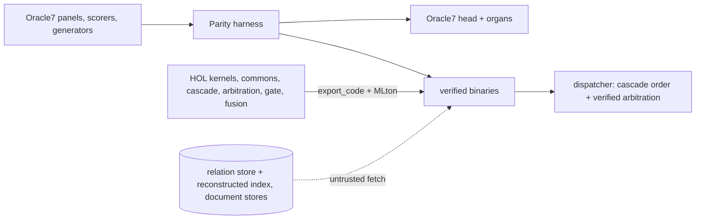

# veri7vn

**Oracle7's sibling, with an Isabelle spine.**

[Oracle7](https://huggingface.co/psiloceyeben/oracle7) answers from stored,
sourced records and 267 specialists, says "I can't verify that" instead of
guessing, and shows the path every answer took. veri7vn keeps that shape and
adds what Python cannot give it:

- **Assurance.** Each specialist's formulas, the routing cascade, the rule that
  arbitrates between specialists, the fusion planner and the exam that admits
  a new specialist are written in Isabelle/HOL with theorems about them. A
  wrong kernel fails a proof.
- **Metareflective access.** The running system can state what its own
  admission, routing and composition mean, and check a claim against that
  statement instead of only reporting a score.
- **Both directions.** Every proved kernel compiles to a small binary that
  drops into Oracle7 as one of its own specialists; an Oracle7 specialist with
  its panel is lifted into veri7vn and examined there.

Everything veri7vn claims is a number on Oracle7's own specialist panels, with
Oracle7's own scorers, under the six criteria of Oracle7's own exam. The law
that makes the project worth anything is **0 wrong**.

## The board

Full table with every run: [`docs/parity/BOARD.md`](docs/parity/BOARD.md).

| Answerer | Right / wrong on the specialists' held-out panels | Notes |
|---|---|---|
| Oracle7 as shipped (published) | 15,478 / 14 | the control |
| Oracle7 as shipped, reproduced here | 14,667 / 17 false yes | the 129 non-relation readers exact; the 161 relation readers run on a reconstructed linker index over the v1 store, and the 811 missing answers sit on properties the shipped store does not contain |
| veri7vn: 18 family kernels, 131 non-relation specialists | every panel equal to or better than the shipped organ, **0 wrong, 0 false yes** | each miss is one the shipped organ also makes, named in its lane's handoff |
| veri7vn: one relation kernel, 161 readers | 16,284 / **0** of 18,976 panel items | the shipped organs score 16,261 / 11 on the same store; the 11 homonym errors are now proved declines |
| veri7vn: fusion (`network_v3`) | 101 of 102 of Oracle7's fusion answers identical | the last needs the geometry kernel |
| veri7vn beyond parity: chemistry family (B-chemistry, 2026-10-18) | chemistry/chemistry-v3 held-out 281 / 0 wrong / 0 withheld against the shipped organ's 223 / 2 / 56; decay 42/42 against 34/42; same numbers on two fresh generator seeds; cold start 58 ms → 4 ms | the second scoreboard (`project/swarm/BEYOND.md`): 0 wrong stays the law, the other numbers move |
| veri7vn: head routes | word problems 24/24 core items; precision guards 114/114 recorded declines; document route 224/231 status | each with its classified misses |
| veri7vn: dialogue | 236 of 237 recorded verdicts; tests 2, 4, 5 reproduce the published summaries exactly | the harness has a dialogue mode |

Cost of a verified answer: the fleet of 19 binaries is 12 MiB on disk, starts
in milliseconds, uses 4–10 MiB each, median 0.1 ms per question. Oracle7's head
on the same questions: 3.6 s to start, 140 ms median, 1.96 GB resident
([`docs/performance/fleet.md`](docs/performance/fleet.md)).

## The gift

[`docs/handoff/organ-package.md`](docs/handoff/organ-package.md) describes a
package Oracle7's author can drop into `root/specialists/` with no veri7vn
checkout: 125 specialist folders, one verified binary per family for macOS and
Linux with hashes and build receipts, and a README written for him. It passed
its smoke test on both platforms (12,247 panel questions, every reply equal to
the lane runs). It also tells him, with numbers, what we found in his own
release: his exam cannot run a shipped panel as written; the release composes
specialists in front of the head although its constitution says fallback;
under head-first composition no specialist the head half-covers can be
admitted; the lane cap was measured on a 400-question sample; no verdict
carries the file hash the exam promises. The linter at `tools/lint/` says the
same per folder.

## How the pieces fit



A **kernel** is a HOL function from a typed request to a typed outcome, with a
theorem that the outcome satisfies the defining equation (or that a decline is
exactly the stated condition). The **recognizer** that turns English into a
typed request is ordinary code and is labelled untrusted. A **fetch** over a
store is untrusted too, and a verified decision only answers when the fetch
asserts it returned every relevant row. Isabelle exports each kernel to
Standard ML; MLton, which ships inside Isabelle, compiles it to a binary that
speaks the [answerer contract](docs/contracts/answerer.md). No Isabelle process
runs at answer time; builds run on hbox and persvati through
`tools/dev/remote-build`. Shared numeric and text machinery lives in
`src/extract/commons/`.

## Layout

| Path | What |
|---|---|
| `project/PLAN.md`, `project/swarm/` | the plan; lane waves (`WAVE5.md`, `WAVE6.md`), the lane brief, the beyond-parity recipe (`BEYOND.md`) |
| `project/lanes/*.md` | one handoff per lane: theorem statements, numbers, receipts, limits |
| `project/scouts/` | GLM scout briefs, their reports, the triage logs (`TRIAGE-N.md`) |
| `docs/parity/` | the board, the harness manual, dialogue mode |
| `docs/oracle7/CORE.md` | what Oracle7 actually is, with file pointers and route shares |
| `docs/assurance/` | the theorem-quality audit |
| `src/extract/<family>/` | one lifted family each: theories, recognizer, build, scorer, README; `families.json` is the registry |
| `src/extract/commons/` | shared numeric core and SML library |
| `src/isabelle/{routing,specialists,reader,document}/` | the cascade, the contract/arbitration/gate, the exact relation reader, the document route |
| `tools/parity/`, `tools/dispatch/`, `tools/lint/`, `tools/organs/`, `tools/linker/`, `tools/perf/`, `tools/deploy/` | harness, dispatcher, specialist linter, organ package, linker reconstruction, fleet measurement, Linux builds |
| `tools/dev/`, `tools/scout/` | build driver and remote builds; scout launcher and queue |
| `audit/`, `docs/coverage/` | the fold catalogue and the coverage audit of all 305 manifests |
| `upstream/`, `var/` | the Oracle7 drop and local scratch; ignored by git |

## Running things

```sh
# the original Oracle7, from the 43 GB drop (not in git)
cd upstream && ../.venv/bin/python oracle7.py "Who wrote Leaves of Grass?"

# a verified family on its own shipped panels
PYTHONDONTWRITEBYTECODE=1 python3 tools/parity/harness.py \
  --answerer "var/quantity/bin/quantity" --specialist densities,units --split both --out var/parity/demo

# the relation readers on the reconstructed index
ORACLE7_ROOT=var/linker/o7root python3 tools/parity/harness.py --answerer "python3 tools/relations/answerer.py" ...

# a session on hbox, with the generated SML brought back
tools/dev/remote-build hbox src/extract/quantity Veri7vn_Quantity -d src/extract/commons --expect 'VERI7VN_QUANTITY PASS'
```

Read [AGENTS.md](AGENTS.md) before working here. One Isabelle distribution
locally (`/Applications/Isabelle2026-RC1.app`); nothing writes under
`upstream/`; every build is green only when a remote-build receipt says so.

## What is not done

The 30 properties absent from the shipped relation store (1,814 panel items)
need data that did not ship. The recognizers are untrusted code in every
family. Several lanes' theorems restate definitions rather than bind to a
specification; the audit in `docs/assurance/` lists them and wave 6 fixes
them. Beyond-parity lanes are only beginning. The code organ has no panel and
no core-panel question reaches it, so it is parked.

The audited Oracle7 revision is `c5d6a29d5bc5e2525078e5a53afa1abf659e4d69`.
Code here is CC0 (`LICENSE.md`); Oracle7 itself is Apache-2.0 code with
per-source data licences (`upstream/DATA_LICENSES.md`).
