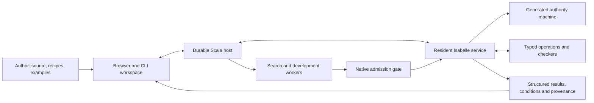

# veri7vn

**An Isabelle-native workshop for building, understanding and deploying specialists.**

veri7vn is being built as a home for Oracle7-style capabilities: small programs
that recognize questions, work with particular kinds of knowledge or computation,
and contribute answers to larger tasks. A specialist might query a source,
calculate with units, find a graph path, apply a rule, or propose a plan.

The aim is to make those capabilities easier to grow and safer to compose.
A specialist's editable package brings together its meaning, language bindings,
sources, implementation, examples, assumptions and evidence. Authors should be
able to follow a result back to its source or proof, repair a failure, measure an
implementation, and ship the improvement to an ordinary end-user installation.

The project grows out of a source-level audit of Oracle7. It preserves useful
behavior, repairs identified defects, and keeps missing data and unsupported
behavior visible. The intended handoff is an environment Psiloceyeben can continue
developing, with both approachable specialist recipes and native Isabelle work.

## Where to begin

| If you want to… | Start here |
|---|---|
| Try the installed source editor | [Installed specialist workshop](docs/tutorials/installed-source-workshop.md) |
| Import an original Oracle7 specialist | [First specialist tutorial](docs/tutorials/first-specialist.md) |
| Run and inspect the current installed capabilities | [Operation reference](docs/reference/recipient-operations.md) |
| Understand what works and what remains | [Whole-project review and horizon](project/REVIEW.md), then the [work board](project/BOARD.md) |
| Understand the system design | [Architecture](docs/ARCHITECTURE_PROPOSAL.md) and [interface contracts](docs/contracts/README.md) |
| Examine the assurance story | [Admission](docs/formal/admission.md), [proof obligations and trusted boundaries](project/PROOF_OBLIGATIONS.md) |
| Build or contribute | [Development checks](tools/dev/README.md), [working agreement](AGENTS.md) and [task ledger](project/tasks.json) |

## What works today

**Development preview, with a working local installation on macOS ARM64.**
The checked standalone package launches outside the checkout using its shipped
runtime, without a system Python interpreter or source compiler. It has exercised:

- Importing and reopening original source; locating bundled native examples.
- Opening a specialist in the browser, saving two successive revisions, closing
  normally and reading the exact edited source in a fresh process.
- Executing installed exact arithmetic through the native service and recovering
  its licensed result and provenance after a restart.

See the [installed evidence summary](tests/deployment/evidence/standalone-aae0d7dd.json)
and [deployment instructions](docs/deployment/local-staging.md). These results
refer to a pinned package, not every newer file in the working tree. Distribution
licensing and Linux qualification remain open; there is no general release yet.

**Editing a specialist does not yet install its changed behavior.** The complete
edit → build → diagnose → repair → admit → qualify → activate workflow is being
integrated. Deployed search, conversations, source-backed domain operations and
behavioral comparison also have active implementations whose complete installed
workflows remain to be checked. The [project review](project/REVIEW.md) separates
working paths, checked components, drafts and untouched scope.

## How it fits together

Three mechanisms share one application:

1. **Native HOL developments define meaning.** Authors can introduce definitions,
   specifications and theorems in Isabelle. Specialist recipes provide a more
   approachable way to author recurring families.
2. **An executable HOL authority model governs accepted state.** Its generated ML
   transition function runs in the native service. It controls publication,
   dependencies, ownership, cancellation and forgetting.
3. **Typed family languages provide efficient execution.** Queries, numerical
   operations, plans and checkers connect to their meanings through concrete
   representation and refinement results. Stable kernels compile once; new data
   and supported recipe instances can reuse them.



The diagram is the agreed architecture; the [review](project/REVIEW.md) records
which connections are qualified. Search proposes candidates; acceptance checks
their actual evidence. A source report remains a source report. A proof about a
physical model does not prove that the world follows that model. Kernel proofs,
refined computations and observed evaluations retain their different meanings.

## Explore the surface area

| Area | What it covers | Read next |
|---|---|---|
| Authoring and packages | Canonical source, imports, revisions, examples, repair and transfer | [Author workflows](docs/workbench/interaction/README.md), [package contract](docs/contracts/package.md), [original workbench audit](docs/workbench/audit/README.md) |
| Language and composition | Lossless inputs, typed readings, ambiguity, conditions, multipart answers and routing | [Request/result contract](docs/contracts/request-result.md), [architecture](docs/ARCHITECTURE_PROPOSAL.md#requests-language-and-useful-output) |
| Sources and knowledge | Facts, relations, documents, missing stores, provenance, query coverage and source change | [Coverage guide](docs/coverage/README.md), [source/lifecycle residual matrix](docs/coverage/classification/residual-matrix.md) |
| Mathematics and engineering | Exact arithmetic, symbolic fragments, quantities, graphs and the wider domain portfolio | [Mathematics source](src/families/mathematics/), [quantity example](examples/specialists/domains/Quantity_Specialists.thy), [reviewed domain profiles](docs/coverage/classification/domain-profiles.json) |
| Search and growth | Budgeted proof search, retained results, candidate programs and behavioral qualification | [Search strategies](docs/search/strategies.md), [strategy contract](docs/contracts/strategy.md), [retained candidate example](examples/growth/retained-identity/OBLIGATIONS.md) |
| Native extension | Original Isabelle developments, controlled construction, admission and reconstruction | [Native development](docs/formal/native-development.md), [recovery](docs/formal/native-recovery.md) |
| State and effects | Conversations, managed sources, cancellation, controlled acquisition, revocation and Forget | [Operational model](docs/formal/operational.md), [environment contract](docs/contracts/environment.md), [runtime omissions audit](docs/review/runtime-gaps.md) |
| Execution and deployment | Prebuilt runtime, dependency closure, recovery, cost attribution and future refinement | [Local staging](docs/deployment/local-staging.md), [runtime closure](docs/deployment/runtime-closure.md), [installed performance observations](docs/performance/installed-runtime-pilot.md) |
| Assurance and handoff | Theorem-to-implementation connections, trust assumptions, acceptance and independent use | [Proof obligations](project/PROOF_OBLIGATIONS.md), [product acceptance](docs/product/ACCEPTANCE.md), [recipient rehearsal](docs/handoff/recipient-rehearsal.md) |

These are areas of the project, not a list of completed features. In particular,
many reviewed domain profiles, real connectors and richer growth workflows still
need implementations. The six Oracle7 siblings are
[compatibility investigations](docs/review/sibling-gaps.md); their full products
are not included in the core migration commitment.

## Working on veri7vn

The current development toolchain is Isabelle2026-RC1. Native checks use bundled
HOL, workspace-local state and a shared build lock. Start with the
[development guide](tools/dev/README.md); coordinate scoped checks when other
contributors are building. The default smoke check is not a whole-product test.

```sh
python3 tools/project.py check
python3 tools/project.py ready
python3 tools/dev/check-native
```

The [plan](project/PLAN.md) defines completion, [decisions](project/DECISIONS.md)
record architectural choices, and [tasks.json](project/tasks.json) owns status and
dependencies. [BOARD.md](project/BOARD.md) is generated from that ledger.
[Validation](project/VALIDATION.md) records scoped results and their limits.

| Directory | Contents |
|---|---|
| `src/isabelle/` | Native model, admission, language, plans, search, sources and growth |
| `src/families/` | Concrete specialist meanings, implementations and their bridges |
| `src/runtime/`, `src/workbench/`, `src/cli/` | Host, persistence and author-facing consumers |
| `src/deployment/`, `tools/deploy/` | Standalone launcher and package construction |
| `examples/`, `tests/`, `benchmarks/` | Author material, scoped checks and measured workloads |
| `docs/`, `project/`, `schemas/` | Design, tutorials, contracts, work graph and package structure |
| `audit/`, `tools/audit/`, `experiments/` | Upstream evidence and isolated research |
| `upstream/`, `var/` | Ignored upstream checkout, corpora, local builds and test artifacts |

The audited Oracle7 revision is `c5d6a29d5bc5e2525078e5a53afa1abf659e4d69`.
Some advertised relation/name stores and extraction provenance were unavailable.
Their absence prevents original-data parity, not development of the readers.
The [coverage ledger](docs/coverage/README.md) keeps that distinction explicit.
The earlier Python/IR/C prototype was [retired](docs/design/prototype-cleanup.md);
its recoverable history is separate from this native implementation.
