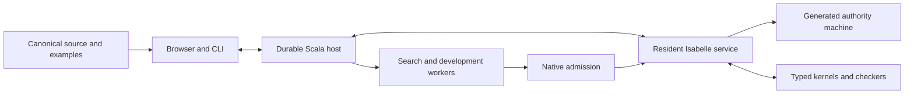

# veri7vn

**An Isabelle-native workshop for building, understanding and deploying specialists.**

A specialist recognizes a question, computes or queries something, and contributes
a scoped result. veri7vn brings its editable source, language, meaning, examples,
implementation and evidence into one package. Authors should be able to inspect
why a result followed, repair the specialist, measure it and deploy the revision.

Oracle7's recognizable path remains the migration target: readers interpret input;
routing selects specialists; calculators, sources and synthesis propose results;
final checks determine delivery and conversational adoption. veri7vn makes readings,
conditions, source reports, failures and effects explicit rather than composing
answer strings. Shared family kernels replace repeated implementations; native
Isabelle definitions and proofs remain open to extension.

## Start here

| Purpose | Entry point |
|---|---|
| Try packaged authoring | [Installed workshop](docs/tutorials/installed-source-workshop.md) |
| Import original Oracle7 source | [First specialist](docs/tutorials/first-specialist.md) |
| Run/inspect installed operations | [Operation reference](docs/reference/recipient-operations.md) |
| See complete scope and remaining work | [Project review](project/REVIEW.md), [board](project/BOARD.md) |
| Understand semantics and interfaces | [Architecture](docs/ARCHITECTURE_PROPOSAL.md), [contracts](docs/contracts/README.md) |
| Check assurance | [Proof obligations](project/PROOF_OBLIGATIONS.md), [admission](docs/formal/admission.md) |
| Contribute | [Development guide](tools/dev/README.md), [AGENTS](AGENTS.md) |

## Current availability

A pinned local macOS ARM64 package launches outside the checkout with its shipped
runtime, without system Python or a source compiler. Checked paths include original
source import/reopen, bundled identity-example editing through two browser Saves
and fresh-process readback, and installed native arithmetic with restored licensed
result/provenance. [Standalone evidence](tests/deployment/evidence/standalone-aae0d7dd.json)
identifies the exact package. Linux and redistribution remain open; this is a
local development preview, not a general release.

Editing source does not yet activate changed specialist behavior. Build/repair,
admission, qualification and activation are distinct integration gates. Search,
dialogue and source-backed operations have component implementations; the
[review](project/REVIEW.md) distinguishes drafts, qualified paths and untouched
scope. A working arithmetic example is not whole-system completion.

## System map

Native HOL defines meaning. Typed family interpreters and kernels execute supported
fragments through representation/refinement bridges. A generated HOL authority
machine governs accepted transitions. The Scala host provides durable storage,
processes and controlled I/O; browser and CLI consume the same operations.



Search proposes; native admission checks. Source reports remain source-relative.
Kernel consequence, refined execution and explicitly enabled oracle consequence
retain different assurance boundaries. The [architecture](docs/ARCHITECTURE_PROPOSAL.md)
defines the joins; the tracker records their implementation state.

| Area | Documentation |
|---|---|
| Packages and authoring | [Package contract](docs/contracts/package.md), [workflows](docs/workbench/interaction/README.md) |
| Language/composition | [Request contract](docs/contracts/request-result.md) |
| Sources and migration | [Coverage](docs/coverage/README.md), [residual matrix](docs/coverage/classification/residual-matrix.md) |
| Mathematics/domains | [Mathematics](src/families/mathematics/), [domain profiles](docs/coverage/classification/domain-profiles.json) |
| Search/growth | [Strategies](docs/search/strategies.md), [candidate example](examples/growth/retained-identity/OBLIGATIONS.md) |
| State/effects | [Operational model](docs/formal/operational.md), [environment](docs/contracts/environment.md) |
| Native extension | [Development](docs/formal/native-development.md), [recovery](docs/formal/native-recovery.md) |
| Deployment/performance | [Staging](docs/deployment/local-staging.md), [measurements](docs/performance/installed-runtime-pilot.md) |
| Acceptance/handoff | [Criteria](docs/product/ACCEPTANCE.md), [recipient rehearsal](docs/handoff/recipient-rehearsal.md) |

## Development

```sh
python3 tools/project.py check
python3 tools/project.py ready
python3 tools/dev/check-native
```

Use the shared build lock and pinned Isabelle2026-RC1 toolchain. The default smoke
check is scoped. [PLAN](project/PLAN.md) defines completion,
[DECISIONS](project/DECISIONS.md) records design, [tasks.json](project/tasks.json)
owns status and [VALIDATION](project/VALIDATION.md) records evidence.

Source lives in `src/isabelle/`, `src/families/`, `src/runtime/`, `src/workbench/`,
`src/cli/` and `src/deployment/`. `examples/`, `tests/`, `benchmarks/` provide author
material and checks; `audit/` and `experiments/` hold research evidence. Ignored
`upstream/` and `var/` contain downloaded sources, corpora and local runtime state.
The audited Oracle7 revision is `c5d6a29d5bc5e2525078e5a53afa1abf659e4d69`.
Unavailable original stores prevent data parity, not reader development. Six
[sibling projects](docs/review/sibling-gaps.md) remain compatibility investigations.
