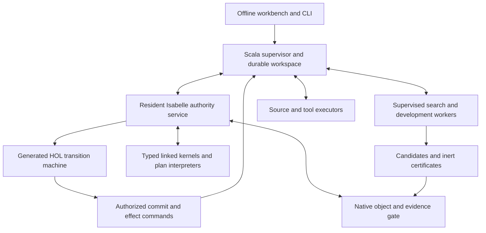

# veri7vn architecture proposal

Revision 2, 2026-10-15. **Agreed architecture; scoped implementation authorized.** This replaces the earlier architectural sketch. It resolves
common choices from the [shipped-behavior audit](review/PREIMPLEMENTATION.md) and
the [semantic](design/semantic-core-review.md), [runtime](design/runtime-review.md),
[authoring](design/authoring-review.md) and
[adversarial](design/adversarial-design-review.md) reviews. Those reports supply
detail and evidence; this document is the common design.

The native scaffold and probes establish a few prerequisites, not this system.
The abandoned Python/IR/C prototype has been
[removed](design/prototype-cleanup.md); Git retains its history.

## Product and architectural choice

Build an **Isabelle-native specialist development and execution environment**.
One installation supports ordinary questions, source acquisition, authoring,
debugging, proof search, code experiments, qualification, deployment and growth.
Psiloceyeben should recognize his capabilities, understand deliberate repairs,
and continue developing them without us. A blank editor or a metatheory detached
from the executed implementation does not complete the project.

Choose three complementary mechanisms:

1. **Open native HOL developments define meaning.** New native types, definitions,
   specifications and theorems remain possible. Approachable specialist recipes
   generate ordinary declarations and obligations. There is no universal closed
   value type or internal truth predicate limiting future mathematics.
2. **One executable HOL authority machine controls the application.** Generate
   its transition function to ML and execute that function in the resident native
   service. It governs accepted bindings, routing constraints, state commits,
   publication, dependencies, permissions and lifecycle transitions. UI and host
   handlers do not maintain independent acceptance policies.
3. **Typed family languages provide efficient computation and optimization.**
   Concrete native representation/refinement/checking theorems connect their
   interpreters, transformations and compiled kernels to their meanings. They
   cover supported fragments; they do not evaluate arbitrary HOL syntax.

An ordinary ML registry would leave most application behavior outside the
metatheory. A universal deeply embedded language would restrict native growth.
An external orchestrator using Isabelle occasionally would miss the intended
native platform. The chosen architecture gives each mechanism a concrete consumer.



## One development model

A package directory contains canonical `.thy` sources, data/source declarations,
examples, documentation and build metadata. Family commands describe formulas,
rules, readers, queries and strategies. Forms apply source-preserving patches to
those commands against a known revision. Generated native definitions are
inspectable derivatives, not a second editable semantic source. Arbitrary expert
HOL blocks remain intact; forms do not promise to round-trip every development.

| Object | Meaning |
|---|---|
| Development package | Editable source and related materials; may expose many capabilities or only supporting theories/data |
| Release | Immutable built source/dependency closure, admitted bindings and derived artifacts |
| Deployment | Selected releases, assurance/effect policies and source-interface bindings |
| Workspace | Private drafts, conversations, candidate runs, connections and development history |

A capability connects interpretation, native types/specification, implementation
or certificate interface, conditions, representations, state/effects, sources and
qualification cases. A descriptor indexes native objects; naming them cannot
create proof authority. Parameterized recipes factor recurring specialists into
shared implementations and authoring tools. New laws or representations introduce
new obligations, rather than requiring a bespoke application framework.

## Types and actual executable linkage

A semantic profile is a native development with a carrier, representation
relation, codecs, operations and literal/display rules. Shared exact-number,
collection, observation and artifact libraries cover recurring needs. Affine
points/differences, logarithmic quantities, reference frames, calendars, SQL
NULL/blob values and probability models retain distinct laws.

`Rep_P r x` relates a runtime representation to its native meaning; the relation
may be partial. Approximation uses an explicit error relation. Admission binds
specification, actual executable definition, representation/refinement theorems,
modeled failures/effects and selected code setup together. A
`callback + proof_name` registration cannot establish this association.

Native logical objects and executable values are separate channels. A
noncomputable object can be a subject of proof without a runtime codec. Bulk data
stay in typed generated representations and owned buffers, without a HOL term or
JSON object per element. Generic envelopes contain bounded references and
profile/version identities; the generated codecs and native gate maintain the
association with actual values. Tags and unchecked casts are not that bridge.

Each executable generation links a finite signature. Its generated interpreter
uses a finite packing of the participating carriers and exhaustive typed dispatch;
this does not close the universe of native HOL types. Instantiate generic
transition/refinement statements with the actual operation bridges. Cross-profile
edges require identical native meaning plus a representation bridge, or an
explicit admitted semantic conversion with its conditions and error bounds.
Display strings never supply implicit coercions.

Typed plans compose admitted operations and retain unresolved premises. Generic
checking cannot decide arbitrary HOL domain conditions: use established premises,
admitted decidable guards, or explicit conditional/unresolved outcomes. Required
execution-safety/applicability guards must be discharged before a primitive runs;
an unresolved guard suspends or declines that invocation. Source/model premises
may remain explicit in a safely computed conditional result. Effect nodes suspend
through authority commands. Pure regions may be specialized/fused
with a preservation theorem; relevant failures, costs and cancellation boundaries
remain part of their observation relation.

Code equations, serializers, foreign primitives and compiler settings belong to
implementation identity. Changing them reopens affected admission/qualification.
Generated native ML is the first target. Sepref/LLVM and other backends remain
performance work behind the same refinement boundary, without presuming a
verified downstream compiler.

## Requests, language and useful output

A request becomes a typed graph of interpretations and subgoals, with exact
claim scope, dependencies, allowed evidence routes and per-node outcomes. Edges
carry typed bindings rather than reparsed answer prose. Partial results, ordered
collections, prefixes and unresolved obligations stay explicit. A feasible path
and a shortest path have different targets.

Preserve original input bytes while retained. Normalized language views and
literal spans carry source maps: hashing, JSON, code and case-sensitive tokens
consume the intended original payload. Recognizers can produce derivations under
declared grammar/resolution rules. A model may propose interpretations, plans or
prose; it cannot establish the user's intention or accept its own claims.

Versioned routing uses priorities and blockers scoped to interpretations,
premises, capabilities or authority objects. A failed prerequisite cannot be
bypassed by another route to the same blocked claim; an unrelated valid reading
or helpful response act remains possible. Personal-reader precedence and fallback
are migrated from actual dispatch with explicit repair decisions.

A response combines speech acts, claim outcomes, artifact deliveries and a
licensed state delta. Tentative programs, test reports, reference commands and
creative output remain useful without universal proof. Candidate code can be
input data to an authorized test operation; passing examples does not make it an
admitted implementation. Speculative composition retains unresolved obligations.

Scope belongs in the native proposition/specification: source report, model
prediction, empirical test observation and unconditional mathematical result are
different claims. Structured rendering preserves licensed content. Free prose
cannot add accepted facts or session bindings. Final arbitration precedes
answer-derived context adoption; recording the utterance is a separate operation.

## Evidence, search and native privilege

| Route | Default purpose |
|---|---|
| Kernel consequence | Promote reusable logical knowledge by reconstructing a native theorem and auditing target, assumptions, context, sorts and transitive oracle dependencies |
| Refined execution | Run ordinary certified computation through its actual proved implementation and approved code-generation/runtime boundary, without a fresh theorem per arithmetic operation |
| Evaluation-oracle consequence | Explicitly enabled profile only, with its oracle dependency recorded; never a silent fallback |

Search programs can retrieve, apply rules, simplify, split, seek witnesses or
counterexamples, conjecture, synthesize, test and request refinement. Their
registered actions own budget/effect contracts. Learned policies improve proposals
without acquiring acceptance authority. Initially use exact identity and pinned
dependencies for reuse; semantic pruning requires a preservation theorem.

Preserve Oracle7's three synthesis mechanisms—catalogue/toolchain construction,
ordered pipeline search with differential samples, and typed bounded enumeration—
as distinct proposal policies over shared candidate/test/evidence/publication
services. Deployed growth retains logical developments, search experience and
executable artifacts separately. Generalizing examples creates fresh obligations.

Workers return inert family certificates or bounded registered reconstruction
recipes. The general expert fallback is bounded native proof-term reconstruction
with `Proof_Checker.thm_of_proof`. Receiver references are approved; private worker
lemmas expand to approved dependencies. Final auditing still checks hypotheses,
exact target and transitive dependencies. New definitions enter the receiving
lineage through controlled elaboration first. Serialized `thm` handles, arbitrary
Isar/method text and generated ML are not proof transport. Installed RC1 source
supports this design; complete cross-worker transport and its cost remain untested.

Ordinary authoring/growth uses supported declaration and strategy languages.
Expert native development remains available. Arbitrary Isabelle/ML, new axioms,
foreign primitives and unrestricted code setup are privileged runtime/plugin
changes. Process separation provides crash/resource isolation, not by itself a
filesystem or network sandbox. These distinctions must be actual interfaces.

## Executed authority, persistence and effects

The generated function has conceptual form `step(state, event) = (state', commands)`.
Search, UI and background work request transitions rather than directly modifying
accepted state. A small privileged native gate holds real `cterm`, `thm`, context
and typed execution objects in non-rebinding tables. Faithful extraction and
attachment to machine IDs are explicit trusted bridges. Structural checks over
arbitrary IDs do not establish domain truth.

Use one durable workspace writer in the Scala host, with SQLite for its
transactional journal/metadata and immutable content-addressed artifact files.
It persists only native-authorized transition
batches binding expected workspace revision, current authority epoch, event/command
identity and exact delta. A compare-and-swap transaction is the local visibility
point. Conflicts return to the machine; the host does not invent merge/acceptance
rules. Success is reported after durable acknowledgement. Restart reconstructs
committed state and native associations from retained material under pinned
versions, never by rerunning historical questions. Portable receipts locate that
material; they are not native proof authority. Revoked payloads are not resurrected
for replay. Pure arithmetic is not a database transaction; commit at visible
state, artifact and effect boundaries.

All effects—including connector discovery, qualification, preview, background
polling and export—use one attempt path. Record intent durably before dispatch.
The host couples a current-authority check, single-use dispatch-lease consumption
and executor handoff in one claim-and-start operation serialized with
retirement/cancellation. **That handoff is the dispatch linearization point:**
a stale unconsumed permit cannot launch, and retirement cannot slip between
consumption and handoff. Never consume a lease and enqueue an unchecked later
launch. A durably recorded attempt interrupted around handoff may need
reconciliation. The native/host bridge must implement this rule, not rely on an
earlier permission. A crash around launch can
leave an unknown outcome. Retry depends on the executor's real idempotency or
reconciliation contract, not a generic exactly-once promise. Cancellation prevents
further work/publication; late events may reconcile an existing attempt without
reactivating its request.

## Versions, sources and lifecycle

Separate semantic/executable generations, source snapshots/observation events,
workspace/session revisions and current access/retirement authority. Retain event,
receipt and evaluation time with clock basis. Pin all relevant dependencies
initially; selective reuse needs adequacy/update proofs, and pins alone do not
establish freshness. Polling does not create a new executable generation.

Acquisition records actual origin/configuration, selection, quality/missingness
and time. A new poll cannot refresh an old MQTT message's event time. Contradictory
reports remain data. Adoption introduces a scoped premise with provenance, units,
frame and applicability, not a global world-truth axiom. Absence, uniqueness,
counts, extrema and ranking require candidate-region coverage, not only positive
rows appearing in an explanation.

Managed reads propagate conservative dependencies through artifacts, examples,
summaries, learned parameters and caches. Restrict workers to declared inputs or
include all accessible inputs. Retirement policy depends on the operation:

- Retiring a capability prevents new invocations and unconsumed dispatch. Already
  running computations may finish under retained pins and current permissions;
  replacement of an active version likewise need not cancel old requests.
- Retiring a source binding stops acquisition/subscriptions and late observation
  publication. Computations on already retained snapshots and historical
  inspection remain permitted unless access is revoked. Late attempt-status
  reconciliation cannot reactivate the binding or refresh its active window.
- Revoking access cancels dependent pending work, revokes handles and prevents
  late claim/state publication. Forget implies this revocation and additionally
  removes managed payloads and derivatives.

Explicitly curated copies appear in the forgetting impact preview
for a retain/delete choice. Minimal tombstones contain status/opaque IDs rather
than private content; an append-only journal must not retain payloads forever.
External copies/actions and secure forensic RAM erasure are outside managed erasure.

Proposed defaults preserve local history with per-session ephemeral mode, opt-in
gap journaling, seven-day temporary recall and a configurable 24-hour sensor
window. These are product policies, not theorem constants. Forgetting includes
managed learning derivatives, not just the original source row.

Semantic admission, empirical qualification and activation are independent axes.
Candidates may be tested before proof. Activation requires the promised assurance
route, mandatory family/interference tests, dependency/effect compatibility and
resource policy. Regression can repeat; freshness is required for claims relying
on fresh held-out evidence. Track exposure when material becomes available,
including aborted runs and imported history. Evaluation forks isolate memory and
persistent learning. Feedback proposes a policy revision; default activation is
reviewed, and undo creates another revision.

## Native deployment and performance

Package an Isabelle/Scala supervisor using Headless/PIDE, resident Poly/ML authority
workers, bounded search/development workers, offline UI assets, CLI, prebuilt
application heaps, compiled libraries and chosen corpus/solver packs. Normal
startup loads supplied heaps without a hidden HOL-Analysis build. Requests use
versioned protocol commands, not a generated theory document per answer.
Credentials remain host secret references. macOS ARM64 and Linux x86_64 each need
actual deployment evidence.

Use one generated executable bundle for the initial finite signature. Growth
must distinguish these costs:

| Change | Execution behavior |
|---|---|
| Observation, reader configuration, example or ranking data | Reuse compiled family operations; publish the appropriate data/policy version |
| Theorem or declarative definition reifiable with existing operations | Extend/check native lineage and reuse the current bundle; no hidden code-setup mutation |
| New plan over existing operations | Use the compiled typed interpreter and establish the composition contract |
| Hot stable plan | Optionally specialize/fuse into a later bundle, preserving the interpreter path |
| New executable carrier/kernel, foreign binding or code setup | Stage/compile an affected bundle, qualify it and publish an executable generation |

Start with whole affected-bundle compilation and warm base heaps, without inventing
a dynamic SML ABI. Measure cost before partitioning at typed component boundaries.
Old requests keep context/code pins subject to current authority; incompatible
replacements drain old workers. Packed values and continuations belong to their
executable generation. Moving retained session bindings to a new generation uses
an admitted codec/representation migration and an atomic session revision;
unmigratable bindings remain historical/unresolved. Matching type names do not
make an old handle valid in a new bundle. Ordinary learning and source updates
do not rebuild the application.

Compile stable kernels/checkers at build or admission. Keep bulk corpora outside
theorem heaps, using typed batches, indexes and buffers. Fuse pure regions without
erasing failure/effect/cancellation semantics. Exact, floating-point and
bounded-error specifications license different optimizations. Seek compact
witnesses where they improve total search plus checking cost.

Measure cold/warm launch, interpretation, lookup, computation, search, checking,
rendering, allocation/live memory, certificate size, compilation amortization,
updates, cancellation and worker interference from the first integrated paths.
Modeled fuel does not bound an arbitrary tactic/compiler: host resource enforcement
and interruptibility are separate obligations. No speedup is inferred from toy
probes, and end-to-end measurement is not deferred to final hardening.

## Author experience and actual migration

Workbench and CLI share native-backed operations: import/create → inspect →
diagnose → repair → test/prove → profile → activate → export/deploy. Diagnostics
refer to editable source and missing conditions; experts can use Isabelle itself.
UI components remain replaceable. There is no deployed Python semantic server.

Original manifests, cards, panels, scorers, sources and exposure histories enter
a staging workspace with their origin preserved. Known patterns translate to
recipe instances. Unknown Python behavior requires a native port and actual bridge.
Preserved behavior and intentional repairs stay visible. A relabelled opaque
Python wrapper is not a completed lift.

| Service boundary | Completion requirement |
|---|---|
| Owned algorithm/model | Native meaning and actual implementation/refinement/checker, including relevant failures and state |
| Source or external-engine observation | Faithful acquisition/invocation bridge and exact scoped result; external engine/world trust remains explicit |
| External action | Authorized intent/attempt protocol, observed outcome and recovery/permission contract |
| Candidate artifact/workflow | Useful preserved behavior and exact observations, without false promotion into an admitted capability |

SQLite execution with heterogeneous rows, errors and truncation is an engine
observation service; a formally supported SQL fragment is an additional service.
Relabelling an owned mathematical algorithm as an observation cannot complete its
algorithmic lift. Families may span classes. Reachability and product interactions,
not file counts alone, determine migration obligations.

Code experimentation remains a scratchpad with versioned toolchain workers,
artifacts, inputs and observations. Generated Python can be a user artifact under
an explicit execution policy; it is not the platform implementation. Isolation
must be supplied by a real backend or described as trusted code execution. Film
uses the shared explanation graph and retains conditions/source links in local
HTML/video exports. Optional remote media and public-chain adapters use the same
effect/export path without becoming mandatory startup dependencies. Their
first-handoff extent remains an explicit scope decision, not a silent cut.

Missing original relation/name corpora and extraction provenance remain visible.
A replacement snapshot is not the original. Six sibling products remain discovery
and architecture stress cases unless scope is expanded.

## Assurance and remaining decisions

The theorem chain applies to the actual finite signature and admitted operations,
not to unrestricted truth in all HOL:

```text
profile/codec laws + actual operation refinement + conversion theorems
    -> typed composition and licensed result
family reification + optimization/lowering + actual code association
    -> compiled-region refinement
authority preservation + concrete native/effect bridge assumptions
    -> only licensed outcomes/authorized transitions become authoritative
dependency adequacy + update/retention rules
    -> permitted reuse/publication preserve these properties
```

All [PO-01–10](../project/PROOF_OBLIGATIONS.md) remain open with real consumers.
The trust boundary includes Isabelle's logic/kernel and approved declarations,
selected code generation/compiler/runtime, native object/linking gate, faithful
host persistence/execution and declared external primitives. Different assurance
routes use different parts. This is a substantial mechanized system with explicit
trusted integration; it is not a proof of all Scala/ML, the OS, SQLite or human
intent. The algorithm under verification cannot be hidden inside an assumption.
The proof ledger separates formal statements from enumerated trusted-boundary
contracts. Boundary conformance tests qualify those explicit assumptions; they
cannot mark an owned algorithm, authority invariant, finite linking instance or
required refinement theorem as proved.

Agreement fixes the semantic/control split, finite typed linkage, canonical
source, claim/evidence model, commit/effect boundary, dependency/retention model,
growth tiers and deployment shape. Independent lanes must not reinvent these.
Three bounded technical checks remain assigned, rather than silently assumed:

1. Proof recording, private-lemma expansion and bounded receiver reconstruction
   in RC1. Where expansion is impractical, use compact certificates or registered
   local reconstruction, never arbitrary worker-source execution as acceptance.
2. Actual finite heterogeneous implementation/representation linkage and admission
   cost. Parameterized recipes and interpreted plans remain the baseline; bundle
   partition follows measurement.
3. Warm resident startup, protocol, cancellation and interrupted-commit recovery.
   Host API adaptations must preserve the authority/journal contract.

These are targeted implementation probes, not an example-by-example design ritual;
no result is claimed yet. Missing-corpus replacement, remote-adapter handoff scope
and redistribution closure remain explicit product choices. Family algorithms,
tactics, indexes and UI components can evolve within these boundaries.

The native gate, executable linker and durable commit seam receive joint review
before downstream interfaces are frozen. Then work fans out by stable subsystem
ownership with real migrated families supplying instances early. The
[work graph](../project/tasks.json) keeps the full destination. The user agreed
to proceed on 2026-10-15; `design-convergence` is complete. The ten
[adversarial scenarios](design/adversarial-design-review.md#ten-design-discriminator-scenarios)
are design checks and future integration obligations, not passing tests.

Cross-review on 2026-10-15 found no remaining architectural blocker after
incorporating execution guards versus conditional premises, generation-bound
session migration, coupled dispatch handoff, precise retirement modes and separate
formal-proof/trusted-boundary closure. This is design review, not implementation,
formal proof or deployment validation. The user subsequently agreed to proceed,
requested gpt-6.1-sol implementation agents and set an active project goal.
