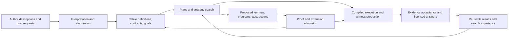

# veri7vn: a native system for reasoning, execution, and growth

Design synthesis, 2026-10-15. **Direction accepted for project management and early
scaffolding; detailed contracts and implementation remain subject to validation.**
This reconciles the design conversation with the three research reports and two
executed Isabelle2026-RC1 probes. The existing arithmetic IR and C emitter remain
experiments. No comprehensive metatheory has yet been implemented.

The intended product is a deployable Isabelle application that absorbs Oracle7's
capabilities and gives its author a useful medium in which to keep developing
them. It should be able to reason, search, synthesize, extend its vocabulary,
improve implementations, and make established work cheap to execute. Its own
operational machinery must have a formal account connected to what actually runs.

## Architectural recommendation

Use **native HOL developments for open-ended meanings**, **specialized formal
languages for manipulable programs and strategies**, and **proof-producing or
verified bridges to efficient execution**.

This is a refinement of the earlier symbolic-language proposal. A permanently
closed datatype of all possible capabilities would constrain future growth.
Ordinary native HOL definitions, types, locales, and theorems can extend the
vocabulary. Meanwhile, explicit plan/query/strategy syntax gives us something
to analyze, transform, compile, and prove operational properties about. A common
composition discipline connects these languages; it need not erase their differences.

The deployed engine lives in Isabelle and works with its contexts, terms, and
theorem values. A conversational client accesses that engine. The primary package
includes prebuilt heaps and native reasoning facilities; restricted extracted
executables are optional projections. Neither extraction nor a fixed capability
interpreter sets the expressive ceiling of the full application.

Each arrow that changes meaning, representation, authority, or persistent state
needs an explicit contract. Drawing it does not establish its correctness.

## What a specialist becomes

A capability is a small formal development plus an approachable authoring view.
Its semantic contract includes:

- input/output types, roles, domain conditions, and the intended specification;
- an executable operation or a procedure that searches for a suitable result;
- representation, state, and effect contracts connecting it to that specification;
- interpretation rules, ambiguity conditions, and answer construction;
- an evidence path, theory/source dependencies, and reuse conditions;
- examples, counterexamples, compatibility decisions, and measured costs.

Tooling should derive routine definitions and obligations from rules, formulas,
sources, and examples. It should explain missing conditions in the author's terms.
Examples guide inference and testing; they do not silently become universal
proofs. Advanced authors can inspect the generated formal objects directly.

The authoring acceptance criterion remains substantial: someone can add a
specialist, understand a rejection, repair it, and obtain a useful deployed
implementation without the original implementers beside them. This needs a real
editor, diagnostics, and assisted obligation discharge, not merely a nicer syntax
for a manifest.

A native-call wrapper is only a migration boundary. It counts as a completed lift
only when its executed operation is connected to the registered meaning. A
coverage ledger must distinguish preservation, deliberate bug repair, unavailable
source dependencies, and remaining opaque adapters.

## Metatheory with concrete consumers

The formal core should describe accepted transitions and their invariants. Search
may propose arbitrary candidates; it cannot bypass acceptance or publish effects
through another route. Native meanings remain open, while generic theorems are
parametric in the contracts of a particular operational signature. Each signature
instance needs a real bridge to its native specifications and implementation.

The following are **proof targets**, not existing theorem declarations:

| Formal target | What it constrains in the running product |
|---|---|
| Interpretation soundness relative to declared language rules | Parsing, entity linking, roles, ambiguity, normalization, and the question actually answered |
| Typing, scope, and applicability preservation | Elaboration and composition; no loss of domain conditions or meaningful flags |
| Primitive and composition refinement | Actual operations and representations implement their contracts, including failures and effects |
| Witness soundness and answer licensing | Evidence supports the exact structured claim rendered to the user |
| Search-policy independence of acceptance soundness | Learned ranking, conjecturing, enumeration, and portfolio scheduling cannot promote unchecked proposals |
| Search-state equivalence or sound subsumption | Deduplication preserves answers, disagreement, and relevant consumption/history conditions |
| Transformation and lowering correctness | Optimized queries, numerical programs, and compiled artifacts preserve the chosen observation relation |
| Extension preservation | New vocabulary, strategies, implementations, and dispatch bindings preserve specified system invariants |
| Dependency adequacy and update correctness | Cached results and incrementally maintained views remain valid under their actual observation dependencies |
| State/effect and budget invariants | Only accepted commits become visible; cancellation, fuel, and external worker behavior have stated contracts |

These compose into an answer guarantee: an accepted answer corresponds to a
declared interpretation, justified claim, permitted assumptions, and the pinned
environment. The real emitter, validators, and execution machinery must refine
the modeled transitions. A parallel model with a separate hand-written runtime
would leave the central obligation open.

This does not require an unrestricted truth predicate for all of HOL, nor a claim
that HOL proves its own unconditional soundness. It requires semantics for our
languages and genuine implementation connections. Open native theorem construction
and fragment-specific executable metatheories serve different roles.

## Reasoning and growth on the end-user machine

Strategies should be manipulable programs over structured goals and contexts.
Actions include retrieval, rule application, simplification, splitting, theorem
search, counterexample search, conjecture generation, program synthesis, testing,
and refinement. Budgets and effect permissions belong to the execution mechanism.
Arbitrary native ML is not a sandbox for code generated by the system.

Retain three distinct products of successful work:

1. **Logical results:** proved lemmas, definitions, and contracts.
2. **Search experience:** useful strategies, traces, rankings, failures, and costs.
3. **Executable results:** specialized plans, algorithms, indexes, and implementations
   connected to their contracts.

The important growth loop includes discovering that several specialists instantiate
one abstraction, or finding and proving a better implementation. Replaying a trace
is useful but is not the whole ambition. Generalizing a successful instance creates
a fresh obligation. Improving a heuristic need not require a soundness proof if
its proposals still pass the same acceptance boundary.

Oracle7 already supplies meaningful starting behavior: bounded quantity composition,
example-guided program synthesis with retained programs, short relational chains,
fixed mathematical families, and empirically admitted template induction. It has
not been shown to orchestrate general Isabelle proof search. The new system must
provide that machinery; attaching a prover does not supply the policy automatically.

## Evidence and computational performance

My proposed distinction is between **promotion into logical knowledge** and
**execution under an implementation guarantee**.

New reusable theorems should normally be admitted through ordinary kernel inference,
with their full context and dependencies accounted for. Fast computation can propose
compact witnesses that make reconstruction cheap. Routine execution of a proved
algorithm can instead rely on its implementation refinement and the explicit code
generation/runtime boundary; producing a fresh native theorem for every elementary
step is unnecessary. An evaluation-oracle theorem is another identifiable assurance
route. These routes must never be silently substituted when a stronger route fails.

This is a refinement of the execution lane's recommendation to default mathematical
claims to kernel reconstruction. The default for extending logical knowledge should
be strict; the performance design must also accommodate efficient certified
computation. The internal result types and deployment contracts must say which
guarantee a result has. Ordinary answer text need not become a list of implementation
warnings.

Compile stable functions, query kernels, and checkers at platform build or capability
admission. Use ordinary efficient ML values inside a running computation, and cross
term/serialization boundaries deliberately. Use refined data structures and specialized
backends where measured costs justify them. Sepref and Isabelle-LLVM are promising
research inputs; RC1 compatibility and the downstream compiler/ABI boundary remain
to be evaluated.

Exact, floating-point, and bounded-approximation specifications must remain distinct.
Error bounds can license optimizations that equality cannot. Search deduplication
and numerical rounding also need semantic justification: changing a cache key can
change an answer, not merely its speed.

## Sources, language, and change

Keep source reports as versioned data. A claim about what a source says differs
from a conclusion under adopted premises, and both differ from unconditional
mathematical truth. Preserve conflicting reports without installing contradictory
world assertions as global HOL axioms. Initially, quoted source data and explicit
scoped adoption are a sound basis; an automatic non-explosive consequence calculus
would be an additional design commitment.

Oracle7's missing relation/name stores and incomplete extraction provenance remain
real gaps. A richer replacement import can be useful, but cannot honestly be called
an exact reconstruction of an unknown snapshot or selection policy.

A positive row witness establishes existence. Unique answers, absence, extrema,
counts, and ranking require coverage of the relevant candidate region. Consequently,
cache dependencies include observations of ranges and alternatives, not just rows
that appear in the explanation. Pinning whole snapshot/generation identities is a
safe initial implementation; selective reuse and incremental maintenance need
dependency/update theorems. Set, bag, and annotated provenance semantics also need
explicit choices before applying their respective rewrite rules.

Natural-language interpretation belongs in the assurance design. Recognized
fragments can carry derivations under declared grammar and resolution rules;
ambiguous readings can remain explicit until constraints resolve them. Broader
language models can propose readings or renderings. Neither grammar soundness nor
a theorem about a proposed reading proves that it matches the user's mental intent.
A constrained renderer should preserve the licensed structured answer, whose formal
content remains inspectable independently of prose.

## Deployment and the concrete tool suite

The native package should ship a pinned runtime, prebuilt application heaps,
compiled capabilities, indexed corpora, source and capability manifests, and the
selected solver/checker dependencies. Normal launch must not unexpectedly build
HOL-Analysis. A resident process amortizes runtime and data loading. New capabilities
form explicit theory/runtime generations; running requests keep their pinned
generation. Replayable development artifacts accompany runtime-specific heaps.

The resulting tools are a capability authoring environment, reproducible source
importer, interpretation inspector, plan/strategy engine, evidence and extension
admission package, staged refinement/compiler service, dependency-aware knowledge
store, and deployment builder. Their shared contracts should reduce repeated
recipes rather than create another family of independently maintained specialists.

Performance accounting starts at those interfaces: interpretation, retrieval,
search, computation, evidence acceptance, and rendering; separately measure cold
start, admission/compilation, memory, witness size, cancellation, and update costs.
Amortization and reuse must be measured over real workloads. No target latency or
Oracle7 speedup follows from the present toy probes.

## Evidence available now

- [Metatheory report](research/native-metatheory.md): proposed judgments and
  theorem dependencies, native extension/admission APIs, and implementation bridges.
- [Execution report](research/native-execution.md): staging, search, deployment,
  trust distinctions, and measured probe results.
- [Scry research map](research/scry-background.md): primary literature on planning,
  lemma discovery, learned proof search, refinement, provenance, and incremental
  computation. The authenticated research client keeps the key out of arguments
  and output; retrieved paper text is excluded from repository artifacts.
- [Native admission probe](../experiments/native-metatheory/Native_Admission.thy):
  a locale-scoped generated definition and proved contract transport through a
  concrete interpretation. It also demonstrates that zero subgoals and zero
  oracles do not exclude hidden hypotheses.
- [Native execution probe](../experiments/native-execution/Native_Execution_Probe.thy):
  staged generated ML runs from a prebuilt heap; static evaluation uses the
  `Code_Generator.holds` oracle while the tested simplifier path does not.

The latter two are executed feasibility evidence. The proposed comprehensive
metatheory, authoring environment, verified operational core, and deployable
capability platform remain to be built. The subsequent authorization covers project
management and early scaffolding; [the work graph](../project/tasks.json) records
the remaining implementation and integration obligations.

## Outstanding design work

The recommendation fixes a direction, not every interface. The next design work
is to settle the common capability/composition boundary, the executable acceptance
and state model, source-adoption semantics, and the assurance profiles of deployed
computation. These decisions should be tested against the complete recovered
capability inventory, not used to reduce the destination to an arithmetic demo.

The detailed calculus syntax, initial backend portfolio, compatibility versus
repair decisions, and platform/resource envelope then follow. Foundation work
establishes versioned shared contracts; dependent implementation proceeds through
the project gates as those contracts become concrete. The decision register tracks
the remaining consequential choices and their consumers.
