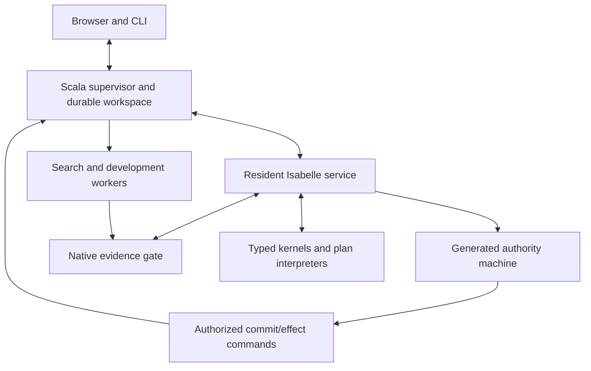

# veri7vn architecture

Revision 2 is the accepted design. [Tasks](../project/tasks.json) and
[validation](../project/VALIDATION.md) record implementation status; this document
specifies the system, not a completion verdict.

## Product and architectural choice

One Isabelle-native installation supports questions, source acquisition, specialist
authoring, diagnosis, proof search, qualification, deployment and growth. The author
owns three connected mechanisms:

1. **Open native HOL** defines types, specifications and theorems. Recipes generate
   ordinary declarations/obligations without imposing a universal semantic datatype.
2. **Generated executable HOL authority** governs accepted transitions, dependencies,
   publication, permissions and lifecycle in the actual resident service.
3. **Typed family interpreters/kernels** execute supported fragments through concrete
   representation/refinement/checking theorems. They do not evaluate arbitrary HOL.



## One development model

| Object | Ownership |
|---|---|
| Package | Canonical `.thy`, data declarations, examples, documentation and build metadata |
| Release | Immutable built closure, admitted bindings and derivatives |
| Deployment | Selected releases, assurance/effect policies and source bindings |
| Workspace | Private drafts, conversations, candidates, connections and history |

Forms patch canonical source against an exact revision, preserving expert blocks.
Generated declarations are inspectable derivatives, not a second editable semantics.
Descriptors locate native objects without creating authority. One lineage serves
human authoring and autonomous growth.

## Types and actual executable linkage

A profile declares carrier, partial representation relation `Rep_P r x`, codecs,
operations, literal/display laws and approximation bounds. Preserve affine/logarithmic
quantities, frames, calendars, NULL/blob and probability distinctions. Native logical
objects need not have executable codecs. Bulk values remain typed buffers, not a
HOL term/JSON object per element.

Each executable generation links a finite carrier packing and exhaustive typed
dispatch. This finite signature does not close HOL. Admission binds actual executable
definition, representation/refinement, failures/effects and selected code setup.
A callback and theorem name are insufficient. Cross-profile edges require matching
native meaning with a representation bridge, or an admitted semantic conversion.
Strings never supply implicit coercions.

Plans discharge runtime safety guards before invocation. Undecidable guards suspend,
decline or remain explicit obligations where safe; source/model premises may survive
in conditional results. Effects suspend into authority commands. Pure fusion requires
preservation of relevant results, failure, cost and cancellation observations. Code
equations, foreign primitives and serialization belong to executable identity.
Generated ML is the baseline; accelerated backends require their own bridge.

## Requests, language and useful output

Requests form typed interpretation/subgoal graphs with per-node outcomes, scope,
conditions, routes and dependencies. Composition uses typed bindings, not prose.
Witnesses, optima, complete collections and displayed prefixes have different claims.
Original literals survive normalized views with source maps. Recognizer derivations
are relative to grammar/resolution policy, never a proof of human intention.

Routing policy versions priorities and blockers scoped to reading, premise,
capability or request. Fallback cannot bypass the same failed check; unrelated
valid readings or clarification remain possible. Final arbitration precedes adoption
of answer-derived conversational state. Recording an utterance is separate.

Responses combine speech acts, claims and artifact deliveries. Tentative code/tests
remain useful without universal admission. Native targets encode source-relative,
model, test and mathematical scopes. Rendering preserves licensed scope/conditions;
free prose cannot add accepted bindings.

## Evidence, search and native privilege

| Route | Boundary |
|---|---|
| Kernel consequence | Exact native theorem with authorized target, assumptions, sorts, lineage and transitive dependency audit |
| Refined execution | Actual admitted implementation and input/output association under its code/runtime assumptions |
| Oracle consequence | Explicit allowed oracle dependencies; never fallback after stricter failure |

Search retrieves, applies rules, simplifies, splits, constructs witnesses,
conjectures, synthesizes and refines within budgets. Learned policies improve
proposals without acceptance authority. Preserve catalogue construction, ordered
pipeline search and typed bounded enumeration as separate proposal mechanisms over
shared lifecycle services. Retain logical results, executable improvements and
search experience separately; generalization creates obligations.

Workers return inert family certificates, registered bounded reconstruction recipes
or bounded proof terms checked by `Proof_Checker.thm_of_proof`. Expand private lemmas
to approved receiver references; establish new definitions in receiving lineage first.
Audit the reconstructed theorem. Arbitrary ML/Isar, serialized theorem handles,
new axioms and code setup are privileged development/plugin operations. A subprocess
provides crash/resource isolation, not a filesystem/network sandbox.

## Executed authority, persistence and effects

The actual generated reducer computes `step(state,event)=(state',commands)`. Native
gate-owned non-rebinding tables associate machine IDs with real contexts, terms,
theorems and execution objects. Faithful extraction/attachment is an explicit
trusted bridge; structural checks over IDs do not establish domain truth.

One Scala writer commits exact authorized batches to SQLite plus immutable blobs,
checking expected revision, authority epoch, identity and delta. Install/force blobs
before journal references; acknowledge only after durability. Serialize relevant
native transitions through precommit and acknowledgement: epoch/revision alone may
miss a blocker change. Conflicts return to native control, not host merge policy.
Restore reconstructs committed native associations under pinned versions without
rerunning questions/actions. Receipts locate retained material, not theorem authority.

Every I/O path uses durable intent and current authority. Dispatch linearizes at
serialized claim-and-start: check authority, consume one-use lease and hand off to
the executor without an unchecked later queue. Cancellation/retirement cannot race
between those steps. Crash near handoff may leave unknown outcome; reconciliation
and retry follow the connector's actual protocol, never generic exactly-once claims.

## Versions, sources and lifecycle

Separate semantic/executable generations, source/observation versions, session
revisions and current access epoch. Pins preserve historical meaning, not freshness
or perpetual access. Event, receipt and evaluation clocks remain distinct.
Source reports retain origin/configuration, selection, quality and missingness.
Adoption is a scoped premise, not a world axiom. Absence, uniqueness, aggregates and
ranking require candidate-region coverage. Start with whole-generation dependencies;
selective reuse requires adequate observations and actual instrumentation.

Retirement stops new capability invocation or source acquisition; existing retained
computations may finish under current permissions. Source retirement denies late
observation publication. Revocation cancels dependent pending work and late claims.
Forget additionally removes managed payloads/derivatives and worker roots. Curated
copies appear in impact previews. Minimal status records contain no private payload;
external copies/actions and forensic erasure are outside managed deletion.

Admission, empirical qualification and activation remain independent. Qualification
forks memory/durable learning, records exact baseline/candidate/scorer/policy and
exposure, and durably consumes eligibility before access. Aborted exposure is not
freshness refunded. Feedback proposes a versioned policy; default activation is reviewed.

## Native deployment and performance

Ship Isabelle/Scala Headless/PIDE, resident Poly/ML, bounded workers, offline UI/CLI,
prebuilt application heaps and selected data/solver packs. Normal startup loads
artifacts, not a hidden HOL-Analysis build. macOS ARM64 has finite installed evidence;
Linux x86_64 and redistribution need separate closure.

| Change | Required execution work |
|---|---|
| Data, examples, reader/ranking configuration | Version/qualify instance; reuse kernels |
| Theorem or definition represented by existing operations | Admit lineage/reification; no bundle compilation |
| Typed plan | Check composition; interpret existing signature |
| Hot stable plan | Optional proved fusion in a later bundle |
| New carrier/kernel/foreign binding/code setup | Compile, link and qualify executable generation |

No dynamic SML ABI is presumed. Session values cross generations only through
admitted codecs/migration, atomically versioned; incompatible values remain historical.
Keep bulk data outside theorem heaps. Measure startup, admission, interpretation,
retrieval, search, computation, checking, durability, rendering, memory and I/O.
Toy timings do not establish application speedups.

## Author experience and actual migration

The complete loop is gap → candidate → edit → build/diagnose → test/prove → profile/
refine → qualify → release/activate. Native expert access and approachable commands
share source ownership. Coverage classifies owned algorithms, source/engine
observations, actions and candidate workflows; observation relabeling cannot complete
an owned algorithm lift. Preserve local code experimentation and Film explanation
exports with conditions/provenance. Optional remote media/public registry adapters
use effect/export authority and have explicitly scoped delivery decisions.
Unavailable original corpora stay visible; replacements identify themselves.

## Assurance and remaining decisions

```text
profile/codec + actual operation/conversion refinement -> typed composition
reification + optimization/lowering + code association -> compiled refinement
authority invariants + faithful native/host bridges -> licensed publication
dependency adequacy + lifecycle/update rules -> permitted reuse
```

[PO-01–10/TB-01–05](../project/PROOF_OBLIGATIONS.md) separate required proofs from
trusted-boundary qualification. Trust includes kernel/foundation, selected code
setup/compiler/runtime, native gate, host durability and declared external primitives.
An owned algorithm cannot be hidden in assumptions. See [semantic rationale](design/semantic-core-review.md),
[runtime design](design/runtime-review.md), [authoring](design/authoring-review.md)
and [adversarial scenarios](design/adversarial-design-review.md#ten-design-discriminator-scenarios).
