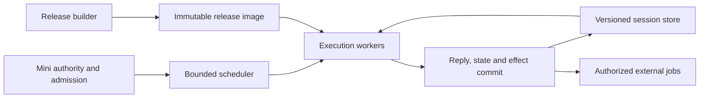

# An Oracle runtime whose cost follows the work

28 October 2026. Architecture proposal, not a deployed replacement. The current
appliance remains the signed 4.9-based v7 composition. This investigation reads
upstream 10.1 at `c473d28914e480425adb29b4f7f42485b8cfb4e3`.

We want dozens of users and agents to share Oracle's complete capability surface
without constructing an Engine for each tenant or losing conversations when a
worker is evicted. A handful of faster specialist routes cannot provide that.
The proposed foundation is a shared immutable release image, explicit session
state, bounded execution, and a durable boundary for effects. Rust is a strong
candidate for that foundation; Python remains useful for authoring specialists
and experiments. This is a design recommendation, not a measured Rust speedup.

## What the evidence establishes

The retained Linux startup profiles of our **older 4.9-based composition** show:

| Observation | Meaning |
| --- | --- |
| Lazy readiness 10.84 seconds; Engine construction about 10.17 seconds | Catalog deferral alone does not make a new tenant cheap |
| Engine PSS 393,242 KiB; private dirty memory 354,676 KiB | Sharing corpus files leaves substantial private process memory |
| Catalog subsequently takes about 8.86 seconds | An agent that discovers operations still pays this work |
| Source compilation about 1.16 seconds at Engine completion | Precompiled bytecode alone cannot remove most startup cost |

These were observations on a loaded host, not latency targets or measurements
of 10.1, nor an attribution of all private memory to Python objects. SQLite
caches and native buffers also contribute. Receipts live
locally in `var/startup-profile/phase-{a,b,c,d}-receipt.json`; interpretation and
previous experiments are in [U6 startup](../../project/lanes/U6-startup-profile.md).
The v7 32-tenant exercise used one Engine, not 32 simultaneous Engines. It showed
bounded memory, not inexpensive tenant switching or complete state persistence.

Source inspection of 10.1 establishes more specific ownership problems. Paths
below are relative to the pinned upstream tree; `admitted/` means
`root/fable-content/oracle-m-series-2026-08-15/self_loop/admitted/`.

| Source | Current coupling | Required separation |
| --- | --- | --- |
| `oracle7.py`, `root/wander-train/oracle_release_runtime.py` | Environment, state directories, executor, resources and sessions are constructed together | Explicit image, worker and session inputs |
| `workbench/swarm/organs10.py`, `reader_cache10.py`, `organs101.py` | Release-derived learned tables live under the writable workspace; loading rebuilds objects and changes module globals | Build tables once per release; open immutable tables when serving |
| `workbench/swarm/steps_kb.py` | JSON knowledge base is materialized into dictionaries, sets and relation lists | Compact indexed storage with queries over shared data |
| `workbench/swarm/clause101.py` and `reader_cache10.py` | Learned tables coexist with `level2`, `reach`, counters and `fcache` | Request scratch and bounded caches separate from shared tables |
| `admitted/oracle_release_runtime_w572.py`, `admitted/oracle_release_runtime_w574.py` | Background organ loading changes answer availability; prior answers and physics inputs feed later lessons | Explicit readiness and versioned session/effect state |
| `admitted/oracle_release_runtime_w480.py` | A timeout abandons a still-running thread | Capacity stays occupied until work actually stops |

The last issue has a controlled reproduction: four calls to the extracted
published `_run` helper timed out with four jobs still alive. Releasing the test
barrier and joining them left zero alive. This demonstrates the helper's
semantics, not production overload. Receipt:
`var/runtime-architecture-20261028/timeout-reproduction.json`.

The [source inventory](../../tools/usage/runtime_architecture.py) found 403
classes, 370 `chat` overrides and 15 constructors in the selected inheritance
graph, with no unresolved bases. These are static counts, **not** a per-query
execution count or proof that inheritance dominates latency. The traversal is
not Python's C3 method order. It cannot prove purity, complete state ownership,
or isolation; dynamic imports, aliases and indirect mutation require review.

## Ownership in the replacement



**Release image.** Code, operation schemas, the route plan, learned tables,
public indexes and verified programs are built before serving. Its identity
binds all relevant code, data, configuration and format dependencies. Verify it
on admission under protected custody; do not hash the corpus or relearn tables
for a new tenant. Start with existing SQLite indexes where they fit, and test
mapped string tables and adjacency arrays for hot knowledge-base accesses.
Mapping a file is useful only if readers avoid reconstructing its full object
graph. Keep user documents, lessons and private overlays outside the image.

**Session state.** Dialogue referents, prior values, transitions, previous physics
inputs, mood and private overlays become explicit versioned data. Database
connections, executors and global paths are not session state. Tenant identity
comes from Mini's authenticated context. Persist a bounded working state and
its changes; retain history separately instead of rewriting and rereading the
whole conversation every turn. Eviction of a worker must not erase logical
session state. Unsupported state migrations must be explicit.

**Worker and request state.** Database handles belong to workers; temporary
reader flags, memo tables, budgets and cancellation belong to requests. Size
workers by execution demand, not the number of tenant workspaces. Public caches
must depend only on release data. Private query/result caches need tenant scope,
bounded size and eviction. A shared Python dictionary of session IDs does not
isolate ambient filesystem paths or module globals.

**Execution and effects.** The intended interface is conceptually
`evaluate(image, state, request, budget) -> reply, next_state, effect_intents`.
Final admission commits the reply, request digest and next state version
atomically, with session-version conflict detection. Exact retries read that
commit without reevaluation. Authorized network, teaching, growth, ledger and
workspace operations run as explicit jobs with durable intent and outcome
records. Do not promise exactly-once external effects: uncertain outcomes remain
recoverable and visible. Jobs can produce new artifacts or private overlays;
they do not mutate a live shared release.

**Scheduling.** Bound active jobs, queued input bytes, scratch, result sizes and
cache sizes. Use fair tenant admission and backpressure. Cooperative work checks
its budget; opaque or noncooperative work runs in killable worker processes.
Timing out a caller does not free a slot while its job is still running. Start
workers cleanly rather than forking an Engine that already owns threads and
SQLite connections. Operator resource settings and end-user policy are separate.

The resource objective is:

`resident memory ≈ shared hot image pages + workers × bounded scratch + active session data + bounded caches/queues`

It must not acquire a hidden `tenants × Engine heap` term. Measure cgroup memory,
PSS and private memory together; summing process RSS double-counts shared pages.
Memory retained by the language runtime also belongs in the worker budget.

## Where Rust belongs

We have not established Python's absolute performance limit. The current
architecture repeats work regardless of language. A literal Rust translation
that clones a knowledge base per tenant and rewrites history per request would
retain the same scaling problems.

Rust is nevertheless a good foundation for compact data representation, shared
immutable indexes, typed state transitions and explicit ownership of execution
resources. Native evaluators can run on several cores without accessing Python
objects. The current CPython 3.12 runtime's GIL limits concurrent Python execution
([Python documentation](https://docs.python.org/3.12/faq/library.html#can-t-we-get-rid-of-the-global-interpreter-lock)).
Changing interpreter mode alone would not separate state or compact the stores.

Keep Python as an authoring and compatibility layer, with a coarse interface:
one admitted request or batch of index operations crosses the boundary, rather
than one Python callback per relation edge. A native extension can execute Rust
without holding the interpreter attachment, provided that work does not access
Python objects ([PyO3 guidance](https://pyo3.rs/main/parallelism)). An embedded
interpreter does not itself provide tenant isolation or cancellation. Initially
run legacy Python evaluators in bounded processes; move them to shared workers
only after their resource/state/effect contract is established. That interim
containment is not the final memory-sharing result.

Rust also does not make arbitrary work preemptible. For example, a running Tokio
`spawn_blocking` job cannot be aborted by aborting its handle
([Tokio documentation](https://docs.rs/tokio/latest/tokio/task/fn.spawn_blocking.html)).
Use cooperative fuel/deadlines or a process boundary, in either language.

Existing Isabelle-extracted native kernels should participate through the same
execution contract. Rewriting them in Rust would lose their current connection
to proofs unless that connection were rebuilt. Rust memory safety is not a
proof that a specialist answers correctly.

## A migration that exercises the full design

1. Establish allocation and execution traces for a pinned full runtime. Separate
   loading, index construction, parsing, routing, guard work, SQL and persistence.
   Account for actual retained allocations; source size is not a memory profile.
2. Split release building from serving, starting with knowledge-base and learned
   reader tables. Compare the current object representation, an indexed Python
   reader, and a native mapped reader on identical real relation queries. Include
   construction cost, hot/cold lookup, joins, aliases, absence and ambiguity.
   This experiment decides storage and boundary choices, not a toy arithmetic
   benchmark or a promised Rust speedup.
3. Extract complete session state and request scratch. Connect a representative
   conversation across relation lookup, arithmetic, a follow-up, disagreement or
   refusal, and a lesson/effect. Switch tenants, evict the worker, restart, retry
   and cancel. A new fast endpoint that bypasses this composition is insufficient.
4. Replace historical inheritance as the execution plan with explicit stages:
   parse once, derive candidates, apply guards, arbitrate, render and commit.
   Preserve required disagreement checks and terminal refusal behavior. Trace
   the original dispatch first; flattening methods without their ordering and
   narrowing semantics would change the system's meaning.
5. Move the shared data/evaluation foundation into Rust where the experiment
   supports it, with Python specialists and native verified kernels as clients.
   Extend the ownership contract to every operation, including growth, teaching,
   places, packets, sensors and documents. Publish a coverage map of converted,
   contained and unavailable operations; never silently discard capabilities.

At fixed worker capacity, test increasing logical tenant populations and mixed
workloads. Require that memory growth is explained by explicit state, not image
copies; that new tenants do not trigger imports, learning or catalog scans; and
that cancelled jobs either terminate or remain accounted for. Measure first-use
and warm p50/p95 wall time, CPU, private memory and bytes read/written. Inject a
crash between evaluation and commit and test exact retry/state recovery. Compare
specialist panel results and independent truth cases: preserving upstream
wrongness is not a compatibility requirement. No new specialist panel numbers
are claimed by this design investigation.

Mini's cold history verification is a separate cost. Its warm path should use
incrementally validated state while checking the current grant and budget on
each admission. Cold recovery and authority invalidation remain mandatory; an
Oracle image cache cannot substitute for them. The full hosted agent/browser/
restart journey remains an acceptance requirement after runtime integration.

## Upstream coordination and current checkpoint

The upstream seams to propose are explicit resource/configuration injection,
build/serve separation for learned tables, versioned session export/import,
request-local scratch, and an effect/cancellation contract. These improvements
are useful to upstream Python even before a native foundation exists. Submit
focused changes against those seams, with whole-conversation comparisons and
the timeout counterexample, rather than presenting a speculative total rewrite.

Source snapshot: 6,998 source files including the manifest, 39,357,565 bytes, under ignored
`var/runtime-architecture-20261028/source`. The existing contribution checkout
was not overwritten. Reproduce the static inventory with:

```sh
python3 -B tools/usage/runtime_architecture.py SOURCE --output NEW_REPORT.json
python3 -B tools/usage/test_runtime_architecture.py
```

All three scoped inventory checks passed: source is not executed, a diamond is
visited once, missing bases are reported, and method-local imports cannot supply
module inheritance bindings. The pinned inventory reproduced the counts above.

The source tool never imports Oracle. No full 10.1 Engine benchmark, Rust port,
shared-session runtime or appliance upgrade has been completed in this work.
Next implementation work is the release-table ownership split and comparative
index experiment, with session extraction alongside it before shared serving.
