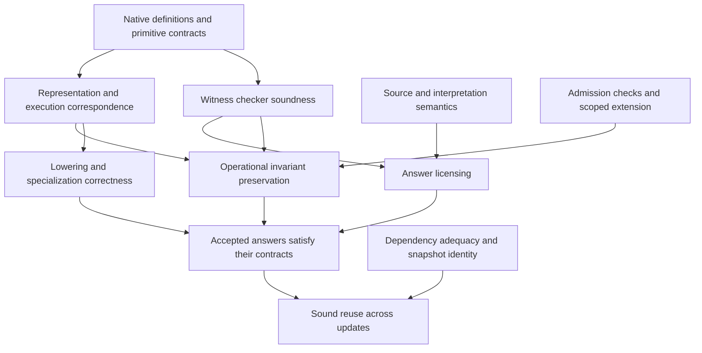

# Isabelle-native veri7vn: proposed metatheory and native architecture

Research proposal, 2026-10-15. Author: `native_metatheory` research agent. This is
input to the design discussion, not an agreed architecture or an implementation
claim. The existing `o7ir/` and `isabelle/` prototypes are unchanged. The only new
executable work in this lane is the isolated context/admission probe described
below.

## Recommendation

Build veri7vn as an Isabelle application whose capabilities have **native HOL
meanings**, whose **operational programs and search states have explicit formal
representations**, and whose native tooling produces the bridges between them.
An open library of definitions and theorems and a deliberately small set of
compositional operational calculi can coexist. We do not have to choose between
an unstructured pile of ML tactics and a closed universal interpreter.

The key distinction is between **logical authority**, **operational authority**,
and **search freedom**. Isabelle's kernel controls the first, a specified and
implemented admission/execution core controls the second, and speculative
policies should have considerable freedom inside the third. Merely running ML
inside Isabelle does not give that ML an executable HOL semantics, bound its
resource usage, or make its handling of sources correct.

The ambitious metatheory should establish how the complete answer-producing
machine behaves: interpretation, source selection, planning, execution,
evidence, answer licensing, state changes, extension, and invalidation. It need
not reverify Isabelle itself before becoming useful. Its claims must be relative
to explicit logical, execution, and environmental foundations.

## What should be shallow, and what should be deep?

Use native HOL terms, types, definitions, and theorems for mathematical meanings
and specifications. A newly discovered operation might manipulate polynomials,
automata, functions, proofs, or a type that does not exist in today's system. Do
not force all of these into a permanently closed datatype of values.

Reify the structures whose syntax is operationally important:

- candidate interpretations, including their source spans, role assignments,
  unresolved choices, and interpretation policy;
- typed plans, relational queries, numerical expressions, and lowered programs;
- strategy programs and search events;
- versioned source observations, selected premises, and coverage obligations;
- dependency/evidence graphs and extension proposals;
- state transitions and externally visible effects.

These need not all be one datatype or one language. A common contract and
composition discipline can connect specialized calculi. Generic control and
search theorems can be parametric in a signature and a primitive transition
relation. A numerical lowering theory can be parametric in primitive denotations.
Each concrete instance must then establish those parameters' connection to its
native HOL specification and actual executable representation.

The native capability registry can be heterogeneous: entries contain certified
terms/types and theorem values, with appropriately scoped metadata. The registry
is an ML implementation structure, not an assertion that arbitrary HOL types
have all been embedded in one HOL value type. Finite generated fragments may
have their own explicit value universe and executable interpreter. Proof-producing
elaboration establishes, for that fragment, the relationship to the native
definition. The monomorphization or representation choices used to compile it are
visible obligations.

For example, the bridge we want is schematically:

```text
native specification S
          ↑ correctness theorem for capability
native executable definition f
          ↕ interpretation/reification theorem
reified program p in signature Σ
          ↕ lowering/refinement theorem or checked certificate
executable representation r
```

An opaque `Native_Call name` does not discharge the bridge. It is only a call
site. Its registry entry must identify the specification, primitive semantics,
concrete implementation relation, effects, assumptions, and evidence path. An
operation lacking that connection remains an explicitly unverified adapter or a
proposal source, not a completed lift.

This hybrid avoids two ceilings. A shallow embedding alone makes syntax-changing
optimizations, search-state equivalence, and compiler analysis awkward. A single
deep embedding of all future Isabelle mathematics imposes a false universal
semantic universe. Defining unrestricted truth for the host logic and then
proving its own unconditional soundness inside that same logic is not the
project's foundation. General reflection is possible under stronger assumptions
or suitable stratification, but those are real design decisions. Fallenstein and
Kumar's HOL4 reflection construction makes the additional large-cardinal
assumption explicit; it is not a free consequence of having a term datatype.
[Primary reflection paper](https://intelligence.org/files/ProofProducingReflection.pdf)

## A capability is a small development, not only a callable

A proposed capability package has the following semantic components. The author
need not write all of them by hand; the package tooling should derive routine
components and explain remaining obligations.

| Component | Meaning |
|---|---|
| Native signature and specification | Parameter types, output relation, applicability conditions, and named domain assumptions |
| Executable definition or search procedure | What computes an answer, or attempts to find one; a specification can exist before an executable realization |
| Contract theorem | The exact relationship between an accepted execution/result and its specification |
| Representation/refinement theorem | Connection from runtime data and executable operations to the semantic inputs, outputs, state, and effects |
| Evidence interface | Witness format, checker semantics, checker soundness, and the mechanism that turns checking into an accepted claim |
| Dependency interface | Which theory, assumptions, source observations, query domains, representation choices, and rule versions matter |
| Interpretation interface | How expressions in the author/user language become invocations, and which ambiguities remain |
| Operational declaration | Read/write effects, error and partiality behavior, budget contract, replay/caching policy, and execution constraints |
| Empirical development record | Examples, counterexamples, tests, measured cost, and compatibility evidence; these do not become mathematical premises implicitly |

For a deterministic pure function, a contract might be a theorem about `f x`.
For partial numerical operations, it includes domain failure. For a database
query, it includes a snapshot and a completeness qualification. For a search
procedure, it can say only that every returned accepted result satisfies a
relation; it need not promise success. For a stateful operation, it relates
pre-state, post-state, output, and effects. These are instances of a common
notion of justified transition, not reasons to erase their differences.

An author's phrase such as "verified on examples" must map to an empirical
property. Oracle7's `CodeOrgan` composes primitives, merges terms by their
outputs on examples, executes the generated source on those examples, and can
retain a successful program. That is a meaningful existing synthesis mechanism.
It does not establish a universal contract or justify replacing a term everywhere
because its examples agree. The new package should preserve this useful search
machinery while adding proof obligations for generalization and global rewrites.
[Inspected implementation](/Users/ember/dev/o7vn/upstream/root/wander-train/code_organ_v3.py:318)

## Native Isabelle integration

The installed RC1 interfaces provide the right construction machinery:

1. Use a local-theory package to introduce capability definitions and derived
   facts through `Local_Theory.define` and `Local_Theory.note`. Parameters and
   assumptions can live in locales; interpretations discharge or instantiate
   them. Authors can get application-specific syntax while retaining native
   formal objects underneath.
2. Keep registry declarations in context data and transport their terms/theorems
   through `Morphism.term`, `Morphism.thm`, and binding morphisms. Capturing a raw
   term or theorem in a global mutable table bypasses the context discipline.
3. Keep per-request proof contexts and immutable snapshots. Shared background
   theories and installed capabilities have explicit generations. Do not mutate
   the background theory of an open proof state in place.
4. Use theorem indexes (`Item_Net` is already used by named theorem collections)
   and compact context data. Do not allocate one `Proof_Data` slot per specialist:
   every slot's initializer runs when a proof context is initialized.
5. Treat deployment admission as building a new theory/runtime generation, then
   publishing that generation at an explicit boundary. Existing jobs remain
   attached to their old context and implementation generation.

Isabelle theory ancestry is nominal construction history, not content equality.
`Context.subthy` and `Thm.transfer` support movement into appropriate descendants.
A cache key consisting only of a theorem's printed proposition or constant names
does not establish compatibility across sessions, independent branches, changed
code equations, or rebuilt artifacts.

Installed references:
[local theories](/Applications/Isabelle2026-RC1.app/src/Doc/Implementation/Local_Theory.thy:10),
[contexts and transfer](/Applications/Isabelle2026-RC1.app/src/Doc/Implementation/Prelim.thy:10),
[context data initialization costs](/Applications/Isabelle2026-RC1.app/src/Doc/Implementation/Prelim.thy:295),
[named theorem registry](/Applications/Isabelle2026-RC1.app/src/Pure/Tools/named_theorems.ML:25).

## Central judgments to mechanize

The notation below proposes interfaces, not already-proved definitions. `Θ` is
the native theory generation; `Γ` is the explicit local assumption context; `W`
is an immutable source snapshot; `Σ` is the capability/primitive signature;
`Δ` is a dependency requirement; and `ε` describes effects.

### Interpretation and execution

```text
Θ; Γ; W ⊢ text ⇝ interpretation ▷ interpretation_evidence
Σ; Γ ⊢ plan : input_type → output_type ! ε
Σ; W ⊢ (plan, input, state) ⇓ (outcome, state', trace)
```

Interpretation evidence establishes a relationship under a declared grammar,
normalizer, entity-linking policy, and context. It does not prove the user's
mental intent. A finite ambiguity set may be maintained and refined by later
constraints; selecting one alternative changes what an answer licenses.

Outcomes should distinguish at least accepted answer, unresolved ambiguity,
inapplicability/decline, unresolved search, resource exhaustion, and execution
failure. Contradictory candidate conclusions also need explicit representation.
`None`, exceptions, false, and timeout must not collapse into one semantic value.

### Evidence and answer licensing

```text
Θ; Γ; W ⊢ evidence : claim ▷ Δ
license(interpretation, claim, requested_answer_form, answer)
```

The checker-soundness theorem establishes that an accepted evidence object
justifies its exact claim under its exact assumptions. A separate licensing
theorem connects that claim to the structured answer. Thus a proved statement
about a source's report does not silently become a proved fact about the world;
an approximate interval does not silently become exact equality; and a result
for one interpretation does not answer every remaining interpretation.

Rendering should consume this licensed structured answer. A constrained renderer
can preserve its assertions mechanically. Free-form generation can propose a
rendering, but verifying its semantic equivalence is a separate problem. The
answer's formal content must remain available independently of prose.

### Refinement and extension

```text
Θ ⊢ implementation refines specification under representation_relation
Θ; Σ ⊢ extension admissible ⇒ Θ'; Σ'
```

Refinement is observational: it includes the distinctions in outcomes and
effects that the contract makes observable. A relational version permits
implementation nondeterminism; equality is appropriate for deterministic pure
functions. Approximate floating-point implementations need an approximation
relation, not an equality fiction. Algebraic reordering requires the appropriate
numerical assumptions.

Admission establishes more than logical consistency. The new item needs a
well-scoped contract, an allowed evidence path, an actual executable realization
when execution is promised, compatible representations, declared effects, and
intact dependency semantics. Installation of a new dispatch rule can change
answers even when it introduces no false theorem; compatibility obligations
therefore concern the operational semantics as well as logic.

### Search and reuse

```text
Σ; W ⊢ search_state --action/event--> search_state'
valid_dependencies(Δ, Θ, Γ, W, runtime_generation)
```

Search actions can retrieve, instantiate, split goals, invoke a reasoning
procedure, propose a program, test a candidate, validate a witness, or request an
extension. Candidate proposal is intentionally permissive. Acceptance, state
commit, and extension are privileged transitions with specified checks.

The search policy can be ML, learned, synthesized, or itself a strategy program.
The primary soundness theorem should quantify over any sequence of legal policy
choices. Policy quality and completeness are different questions. A branch that
fails to find a proof cannot supply a proof of negation. Fairness and completeness
are properties of particular enumerators and fragments, not universal promises.

## Proposed theorem dependency structure



This graph has several distinct proof tasks:

| Target theorem | Concrete consequence | Necessary implementation connection |
|---|---|---|
| Typing and well-formedness preservation | Plan steps do not invent incompatible roles/types or invalid references | Generated or validated elaborator, and checked representation conversions |
| Primitive and composition correctness | Successful composition satisfies the composed contracts | Every executed operation realizes the registered primitive semantics |
| Witness checker soundness | Accepted witnesses license their exact claims | The deployed checker is the extracted/refined checker, or its result is reconstructed natively |
| Acceptance invariant | Every emitted accepted answer has a valid interpretation/evidence/license chain | The real emitter is reached only through the modeled acceptance transition |
| Search-policy independence of soundness | Arbitrary proposal/ranking changes cannot create logical authority | Search cannot bypass acceptance, mutate committed contexts, or execute undeclared effects |
| Search-state quotient correctness | Deduplication preserves permitted answers and conflicts | The actual key realizes the proved equivalence or a validated sufficient condition |
| Extension preservation | Admitted capabilities preserve specified invariants and published compatibility contracts | New generation built through the admission mechanism; its executable image matches its manifest |
| Cache/dependency adequacy | Reused result still means the same thing after an allowed change | Read/dependency instrumentation and context generations cover all semantic observations |
| Lowering correctness | Optimized plan/kernel preserves the chosen semantics | The actual emitted artifact and backend assumptions are linked, not merely a second interpreter |
| Budget/accounting safety | Accounted events obey budgets and cancellation rules | Real workers/processes and FFI obey the operational boundary; logical fuel alone does not bound wall time |

The acceptance theorem can be strong even with unverified search, while the
whole-system operational theorem remains conditional on the concrete scheduler,
storage, parser, and effect interfaces. The report should name those conditions
instead of allowing one theorem about an arithmetic DAG to stand in for them.

## Source assertions, conflict, and changing knowledge

Keep at least three notions distinct:

1. A source artifact contains a particular statement.
2. Under an interpretation and source policy, the system adopts a statement as
   a premise for this reasoning context.
3. A conclusion follows from those premises and the mathematical rules.

Do not add imported factual statements as global HOL axioms. A versioned source
record can be data; membership in that record, the interpretation of its fields,
and the adoption policy have separate meanings. A statement's temporal validity,
observation time, source revision, qualifiers, rank, and units cannot be recovered
by a proof after the import has thrown them away.

For contradictory reports, either keep reports as quoted data and reason about
them, use an explicitly specified non-explosive consequence relation for the
claim language, or choose separately scoped hypothesis sets. Installing both a
proposition and its negation as ordinary classical assumptions and then forgetting
the assumptions yields useless certainty. A consistency test for arbitrary HOL
contexts is not an available general-purpose admission algorithm.

A corpus query has at least a soundness question and a completeness question.
A returned witness may establish that a matching statement exists. Proving that
there is exactly one, none, a maximum, or a complete count requires coverage of the
relevant search domain. An empty result from a missing database is not negative
evidence. A language linker selecting the most popular matching entity has a
ranking dependency even when the selected entity's own record is unchanged.

Large stores should not automatically become millions of theorem objects. A
verified query algorithm can work over an abstract finite database and be refined
to indexed storage; per-result evidence can be compact. But we must still account
for the actual bytes and lookup operations used. Merkle proofs can authenticate
an indexed fragment relative to a committed root; they do not establish that a
source was truthful, and a hash equality is not unconditional mathematical
equality of arbitrary contents. Root binding, serialization, I/O, and any
cryptographic assumption remain explicit parts of that path.

Research on provenance with negation distinguishes successful and failed rule
derivations and makes the relevant query domain explicit. It offers useful
implementation ideas for explanations and pruning, without automatically giving
us a formally verified storage layer. [Primary provenance paper](https://arxiv.org/abs/1701.05699)

## Update and cache semantics

Pin a source snapshot and capability/runtime generation for each computation.
Preserve historical conclusions about an old snapshot; do not silently relabel
them as current. Current answers can be invalidated and recomputed without
retracting mathematical theorems about the historical data.

Dependencies must describe observations, not only positive premise rows. Useful
dependency forms include exact item values, the complete contents of an indexed
range, absence within a range, aggregate summaries with their coverage, entity
alias/ranking versions, grammar/normalizer versions, and resolved capability
bindings. Default resolution, priority, numerical semantics, and memoization
keys also affect meaning.

A central target is dependency adequacy:

```text
adequate(query, dependency_description)
∧ equivalent_on_observations(old_environment, new_environment, dependencies)
⇒ same_semantic_result(query, old_environment, new_environment)
```

Initially, a whole-snapshot generation key is a correct conservative choice.
Selective reuse is an optimization to earn with this theorem and implementation
instrumentation. This is particularly important for negative results, uniqueness,
top-k answers, and all shallowest-plan agreement.

Search has different cache classes. A checked proof can remain valid even when a
heuristic ranking changes. A claim that *no* solution exists in a bounded search
space depends on the whole enumerated space and pruning rules. A timeout record
is only operational history. A remembered promising plan can be reused as a
proposal while being checked afresh under current conditions.

Oracle7's current composition engine searches a typed pool with a bounded plan
depth and intends to decline when shallowest completing paths disagree. That
means preserving a final numeric value alone is insufficient: the conflict and
agreement semantics matter. Its deduplication is a particularly good real target
for quotient-correctness obligations, rather than a generic theorem saying that
an arbitrary hash key is safe.
[Composition engine](/Users/ember/dev/o7vn/upstream/root/specialists/_gate/network_v3.py:1)

## Admission is not just `thm` plus zero subgoals

A native theorem is a sequent in a theory. The gate must match the intended
conclusion, expose/authorize its hypotheses and premise structure, account for
type/sort constraints and unresolved obligations, check its theory lineage, and
apply an explicit oracle/axiom policy. `Thm_Deps.all_oracles` traverses dependency
bodies and joins deferred theorem work; a quick local flag is not equivalent.

The concrete acceptance interface should follow the checks already composed by
RC1's `Goal.prove`, then add veri7vn's policy and execution checks:

| Check | Native mechanism and application obligation |
|---|---|
| Background theory | Compare `Thm.theory_id` with the allowed theory's ancestry using `Context.subthy_id`; use `Thm.transfer` only into an appropriate descendant. Do not silently join an unapproved extension merely to make a theorem usable. |
| Completed proof state | `Goal.finish` and `Drule.flexflex_unique` handle the proof-state boundary. Inspect `Thm.tpairs_of` if accepting theorem values outside that path; unresolved disagreement pairs are not answer content. |
| Declared assumptions | `Thm.check_hyps` checks membership in the intended context. Explicitly inspect `Thm.hyps_of` and `Thm.prems_of`; allowed contextual assumptions must appear in the answer envelope or be discharged. |
| Type/sort conditions | `Thm.check_shyps` validates against the context; `Thm.shyps_of`/`Thm.extra_shyps` expose sort requirements. Class constraints can be legitimate declared parameters; requiring every sort list to be empty would reject valid polymorphic results. |
| Exact target | Match the certified intended statement against the full returned proposition, respecting instantiation and binding. `Thm.concl_of` alone omits premises. Goal.prove uses `Unify.matcher` after its proof checks. |
| Context export | `Assumption.export inner outer` discharges local hypotheses into premises; `Variable.export inner outer` handles local parameters. `Proof_Context.export` composes the normal contextual export. These operations do not prove the premises true. |
| Completed dependency audit | Consolidate pending derivations as required (`Thm.consolidate`); inspect `Thm_Deps.all_oracles` transitively and reject `skip_proof` in checked profiles. A mode allowing a particular computation oracle must name that trust boundary. |
| Allowed theory construction | Approved ancestry plus allowed definitional construction/replay; oracle absence alone does not exclude arbitrary axioms. Native definitions themselves have definitional axioms, so a naive “no new axiom-table entries” rule is also wrong. |
| Executable attachment | Match the accepted contract to the registered implementation, representation relation, frozen code setup, and artifact generation. Kernel theorem acceptance does not do this application-specific check for us. |

This table is a proposed admission contract. The small experiment tests the
locale/definition path and hypothesis-export issue only; it does not implement
the complete gate. [RC1 Goal.prove checks](/Applications/Isabelle2026-RC1.app/src/Pure/goal.ML:192),
[theorem API](/Applications/Isabelle2026-RC1.app/src/Pure/thm.ML:64),
[transitive oracle inspection](/Applications/Isabelle2026-RC1.app/src/Pure/thm_deps.ML:23).

The probe in this lane constructs a theorem value for `2 + 2 = 5` by assumption.
It has **zero subgoals and zero oracles**. It is perfectly legitimate as a sequent
with that same statement in its hypothesis list. Treating it as an unconditional
answer would be an application bug. Exporting its local context exposes the
assumption as a premise; no incorrect arithmetic theorem is admitted.

Similarly, a theorem can be oracle-free while relying on an arbitrary axiom in
its theory. Native ML code has access to theory-building interfaces; the ML
runtime is not a security sandbox. An extension protocol should accept approved
definitional package actions or replayable checked artifacts, not arbitrary ML
with the hope that inspecting one returned theorem is sufficient. A separately
trusted native plugin is a different extension class and should be recorded as
such.

Conservative extension claims need precision. Well-formed constant/type
definitions over the intended definitional foundation have established results;
arbitrary axiomatic base theories and delayed overloading require care. The
mechanized independent-fragment work is especially relevant to claiming that
unaffected meanings survive an update. For runtime extensions, fresh versioned
names and explicit alias rebinding are simpler than changing old polymorphic
instances silently. This is a design preference, not a ban on Isabelle's type
classes. [Definitions and conservativity](https://doi.org/10.1145/3158112),
[mechanized independent-fragment result](https://arxiv.org/abs/2101.03807)

## The execution connection and its assurance modes

Native Isabelle gives multiple materially different evaluation paths:

- Use fast computation to propose a result and build an Isabelle theorem by
  witness-directed kernel inferences. The computation is not logically trusted.
- Run a checker whose soundness is proved in HOL as generated ML. Its answer is
  supported by that theorem and the code-generation/runtime assumptions. Turning
  the Boolean result into a native theorem through an evaluation oracle adds
  that computational stack to the logical trust boundary.
- Execute a refined compiled operation and rely on its verified implementation
  relation plus the specified backend boundary. A native theorem for every
  invocation may not be necessary for every product use, but the product must
  state precisely which guarantee this path supplies.

These paths can share specifications and evidence schemas. They must not be
collapsed into an ambiguous phrase such as "verified reflection."

The installed static computation antiquotations are an important practical
bridge: the generated code is included in Isabelle/ML and compiled once. The
documentation explicitly demonstrates using computed results merely as hints
for constructing an oracle-free certificate. Static computations have finite
input-constant sets and monomorphic input restrictions, so adding a new
capability entails a staging/generation decision rather than magically expanding
an already compiled evaluator.
[Evaluation distinctions](/Applications/Isabelle2026-RC1.app/src/Doc/Codegen/Evaluation.thy:26),
[native computation and certificates](/Applications/Isabelle2026-RC1.app/src/Doc/Codegen/Computations.thy:259)

The metatheory must identify the executable image of its authoritative functions:
the typechecker, dependency validator, evidence checker, acceptance transition,
and extension validator. Either generate these directly from their HOL
definitions or prove/validate the relationship to the optimized implementation.
Writing a matching ML function next to a theorem is not that relationship.

## Tool suite implied by the design

The following are coherent candidate tools, not a committed implementation plan:

- A capability package/editor that creates native definitions, interpretation
  bindings, and understandable obligations from approachable specialist input.
- A source importer with explicit schema/version/provenance and coverage checks.
- An elaborator that preserves ambiguity and produces typed plans with native
  correctness bridges for recognized fragments.
- A strategy engine operating on structured goals and contexts, with retrieval,
  synthesis, theorem search, testing, counterexample search, and bounded workers.
- An evidence and admission engine that distinguishes proposal, empirical fit,
  conditional consequence, checked witness, and unconditional theorem.
- A staged compiler/refinement pipeline for plan optimization, index selection,
  specialization, data representation, and reusable generated ML.
- A dependency-aware result/lemma/program store with explanation and invalidation
  tools; performance measurements belong in its operational record.
- A deployment builder that packages a prebuilt Isabelle application, exact
  theory and executable generations, data manifests, and optional reasoning
  worker capabilities.

These components absorb Oracle7's readers, fact organs, calculators, synthesis,
composition, routing, conversational state, and self-extension in different ways.
The coverage ledger should name each recovered behavior and its intended contract,
preservation or repair decision, implementation bridge, and remaining gap.
An opaque adapter is a useful migration step; it must never count as full formal
coverage just because it has a generic wrapper.

## Executable evidence produced in this lane

Files:
[Native_Admission.thy](/Users/ember/dev/o7vn/experiments/native-metatheory/Native_Admission.thy),
[ROOT](/Users/ember/dev/o7vn/experiments/native-metatheory/ROOT),
[build log](/Users/ember/dev/o7vn/experiments/native-metatheory/build.log),
[recorded probe output](/Users/ember/dev/o7vn/experiments/native-metatheory/probe-output.log).

The `Veri7vn_Native_Admission` session imports only `Main` from bundled HOL. It
successfully:

1. Uses `Local_Theory.define` inside a locale with a parameter and assumption.
2. Derives a capability property, instantiates the locale, and obtains the
   transported theorem without residual hypotheses or oracle dependencies.
3. Demonstrates the hidden-hypothesis admission failure described above.
4. Uses `Assumption.export` to expose the premise correctly.

RC1 reported five seconds for the session and sixteen seconds for the complete
first invocation in its new workspace-local user state. These are feasibility
observations, not a startup benchmark. No HOL-Analysis build was required. The
probe contains no `sorry`, new axioms, or oracles. It does not implement the
proposed gate or prove the operational metatheory.

## Decisions still needing design agreement

1. **Native openness versus fragment boundaries.** Which first operational
   calculi give enough expressive coverage without premature universal syntax?
   My preference is common typed/effectful composition plus specialized query,
   numerical, and proof-search fragments with explicit bridges.
2. **Logical admission versus product acceptance.** Which execution assurance
   modes should ordinary answers permit? Their exact differences should be
   visible in the internal types and answer evidence, not forced into verbose
   user-facing warnings.
3. **Source consequence semantics.** Quoted source reports and scoped classical
   reasoning are immediately compatible with Isabelle; a non-explosive claim
   calculus is attractive if automatic conflict handling is central. Its
   consequence rules require an actual design decision.
4. **Operational authority.** How much of the transition/admission/dependency
   core is generated from HOL from the outset, and which optimized native
   implementations get refinement proofs? Search heuristics need not block that
   work.
5. **Extension generations.** How should a running application publish a new
   native theory/executable image without disrupting ongoing proof contexts or
   preserving stale computational meaning?
6. **Coverage semantics.** What does “same behavior” mean for fragile upstream
   dispatch, heuristic conflict handling, mutable memory, or a documented but
   unshipped data dependency? Preservation and deliberate repair need separate
   claims.

These are consequential choices; the experiment and report intentionally do not
settle them by preemptive implementation.

## Research evidence inventory

Scry was used through the credential-protecting helper supplied by the provenance
lane. Query SQL, returned metadata, schemas, and available primary paper text are
under [research evidence](/Users/ember/dev/o7vn/experiments/native-metatheory/research).
Initial broad token searches included irrelevant title matches; subsequent
queries narrowed the Isabelle and conservative-extension questions. Search
metadata was used for discovery, not as evidence of implementation compatibility.

Primary works inspected include the 2018 definitions/conservativity paper and
the 2016 self-formalization paper (full text via Scry), the provenance-with-negation
paper (full text via Scry), and the proof-producing reflection paper (primary
author-hosted PDF). The latter confirms that full host-logic reflection requires
additional assumptions; we do not inherit them silently. The local RC1 sources
are the compatibility authority for the concrete APIs used in the probe.

Two further primary texts retrieved through Scry were the 2021 mechanized
model-theoretic conservative-extension study and the 2025 study of faithful deep
and shallow logic embeddings. The first explicitly restricts preservation to the
independent fragment and records assumptions on witness-respecting models. The
second demonstrates that simultaneous embeddings and their faithfulness
connections can be useful for both object and meta-level reasoning; its modal
logic experiments are precedent, not evidence that our much broader capability
system has already been designed or verified.
[Faithful embeddings paper](https://arxiv.org/abs/2502.19311)

For a long-term stronger foundation, the self-formalization work is instructive:
it connects inference-system soundness to shallow monadic kernel functions and
then to an implementation relation. That layered composition is the shape of
evidence veri7vn needs for its own operational core. It is not evidence that
Isabelle/ML or the present prototype is already verified.
[Self-formalization paper](https://doi.org/10.1007/s10817-015-9357-x)
